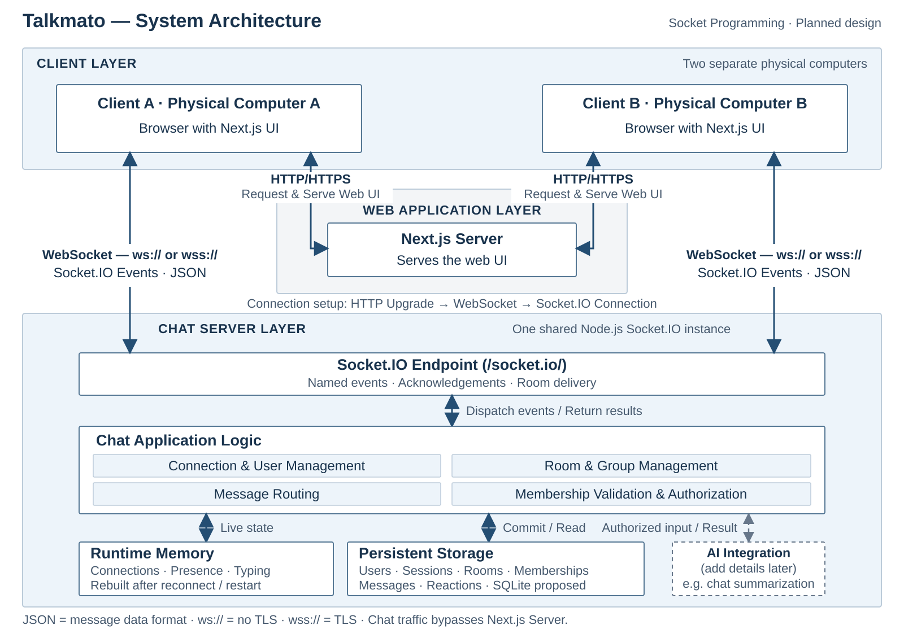

# Talkmato system architecture

Talkmato is a browser chat application built with Next.js/TypeScript and one Node.js/TypeScript Socket.IO backend. Browsers connect directly to that backend with WebSocket-only Socket.IO transport. Next.js does not relay chat messages.

The implementation order and team ownership are in [implementation ownership](implementation-ownership.md) and the prerequisite order is in the [core implementation checklist](core-implementation-checklist.md).

## Selected baseline

- **Accounts:** a first-time user registers a unique name and password. A returning user signs in with the same credentials. The backend stores an Argon2id password hash only.
- **Connection:** a new Socket.IO connection restores an unexpired eight-hour server session only when its HTTP-only cookie is valid. Otherwise it must complete `auth.register` or `auth.login` before any room/history/write command. The browser never stores a password or session ID in JavaScript.
- **Presence:** one active socket per account. A second connection for that account receives `SESSION_IN_USE`. Disconnect clears only the active socket, presence and typing state.
- **Durability:** accounts, rooms, memberships and messages are stored in SQLite. They survive sign-out, browser closure and backend restart when the database file is persistent.
- **Driver:** development uses Node `24.19.0` and built-in `node:sqlite` / `DatabaseSync`. Each developer has an ignored file at `backend/data/talkmato.dev.sqlite`; tests use `:memory:`. `storage.ts` is the only module that opens SQLite.
- **Special features after R1–R11:** room-scoped typing, then Saint’s AI-selected emoji firework. Tomato reactions and AI Voice Chat are not selected.

## Deployment boundaries

For R1, run two browsers on **different physical computers** against one backend. The server may share one client computer or run on a third computer. Two tabs, browser profiles or VMs on one machine do not meet that requirement.

Proposed development addresses are UI `http://192.168.1.20:3000` and backend `http://192.168.1.20:8080`, Socket.IO path `/socket.io/`, namespace `/`. Both clients must use the same reachable backend address, not separate `localhost` backends.

SQLite is an embedded file accessed only by the Node process; it is not a browser-facing service. The generated database, WAL and SHM files are ignored by Git. Public deployment requires HTTPS/WSS because users submit passwords; do not use real passwords over an untrusted LAN. Use disposable course-project accounts for an unencrypted development demonstration.

The optional public deployment runs the frontend, one backend, and Caddy in Docker Compose on one VM. Caddy provides HTTPS/WSS and routes directly to the appropriate container; chat still bypasses Next.js. Only ports 80/443 are public. SQLite and Caddy certificate data use persistent volumes. See [deployment](deployment.md) for setup and recovery.

## R1 protocols

| Layer | What | Why and how Talkmato uses it |
| --- | --- | --- |
| HTTP | Request/response protocol | Next.js serves UI/assets; the backend receives the initial Socket.IO upgrade request. |
| Socket.IO / Engine.IO | Event and acknowledgement layer above WebSocket | Carries named authentication, room, message, typing and AI-effect commands. Use matching client/server libraries, not native `WebSocket`. |
| WebSocket | Persistent full-duplex channel | Delivers immediate bidirectional chat events. It is the only enabled Socket.IO transport. |
| TCP | Reliable ordered byte stream | Carries each client’s WebSocket connection. A new TCP/WebSocket connection is not proof of account identity. |
| IPv4 | Network addressing | Lets two physical computers reach the shared backend IP and ports. |
| TLS in public deployment | Encryption, integrity and server authentication | Protects passwords and chat traffic through HTTPS/WSS. Local HTTP/WS is development-only. |

JSON is the payload format, not a network protocol. SQLite adds persistence but no new network protocol.

## Connection and message path

1. The browser loads the Next.js UI and opens one Socket.IO connection using WebSocket-only transport.
2. The connection begins unauthenticated. The user calls `auth.register` or `auth.login`; the server validates credentials and binds the authenticated account to this socket.
3. The backend returns a snapshot containing self, online users, public groups and that account’s private rooms. It joins Socket.IO delivery channels derived from persisted memberships.
4. The browser requests `room.history` for its selected authorized room and merges saved messages with live events by message ID/sequence.
5. The browser sends `room.send` with a stable `clientMessageId`. The server checks the socket’s authenticated account and persisted membership, commits the message first, acknowledges it, then emits `message.created` to connected eligible members.
6. On disconnect, the backend removes only the live socket/presence/typing entries. Stored account, room, membership and message records remain. A later connection signs in again and reloads authorized history.

## Identity, authorization and history

Names are unique across persisted accounts, including offline accounts. A name alone never authenticates an account or reveals its rooms/history. Store a password hash only; do not expose passwords in URLs, logs, DTOs, source control or browser storage.

An authenticated participant may message an existing private room while the peer is offline; delivery occurs from history when the peer signs in later. Public group details include offline members, while `users.snapshot` includes connected users only and includes the viewer.

Group membership has a permanent first-join history boundary. On a first join, the database records `visibleFromSeq = current maximum message seq + 1` in the same transaction. A returning member retains this boundary; reconnect/sign-in does not create another join. History, message send, typing and AI input must all enforce persisted membership and this boundary.

Socket.IO channels are delivery caches, never authorization. A handler must derive actor identity from the authenticated socket and check persisted membership before reading or mutating room data.

## Reliability rules

| Topic | Behavior |
| --- | --- |
| Unexpected disconnect | Mark user offline and clear typing; retain durable data. |
| Transport reconnect | Retry transport a bounded number of times; restore only an unexpired HTTP-only cookie session, otherwise require sign-in. |
| Browser refresh/reopen | Restore an unexpired eight-hour cookie session, or show sign-in; then load authorized rooms/history. |
| Duplicate login | Reject while the same account has an active socket; do not steal the connection. |
| Send outcome unknown | Do not automatically replay writes. Manual retry reuses the same `clientMessageId`. |
| Message/history merge | Deduplicate by message ID/sequence, never by text. |
| Group join | Creator only initially; others join themselves; a join never exposes older group messages. |
| Sign out | Clear only the current live socket authentication/presence; do not delete account or data. |

## Storage and deployment impact

`backend/src/storage.ts` owns the single `DatabaseSync` instance, schema initialization, parameterized statements and transactions. Enable foreign keys and set a small busy timeout. Keep durable writes transactional before acknowledgement. The committed schema/reset scripts are the reproducible source of truth; generated database files are not committed.

A SQLite file on an ephemeral cloud filesystem does not preserve history after restart/redeploy. Public deployment therefore needs one backend instance and persistent storage before claiming durable history. No Redis, message broker or multiple backend workers are in scope.

## Special feature boundaries

- **Typing:** authenticated room members may emit `typing.set`; only other connected eligible members receive it. It contains no draft text, is throttled, expires automatically and is never stored in SQLite.
- **AI emoji firework:** an authenticated user selects a message they may already read. The backend retrieves authorized persisted text, sends it with bounded catalog choices to Cloudflare Clef, validates one default-form emoji, and returns it to the requester for a local animation. The browser reuses AuthGate's socket. No unrelated history or identity metadata reaches the model, and no reaction or effect is saved or broadcast. See [the pinned catalog, setup and evaluation](saint-ai.md).

For R1, present the diagram, actual reachable backend address, two physical clients and protocol explanation. For R2, show the Socket.IO emit/listen/handler path. Test account login, private/group authorization, group first-join exclusion, message deduplication, persistence after sign-in again, typing isolation and AI message-visibility checks.
