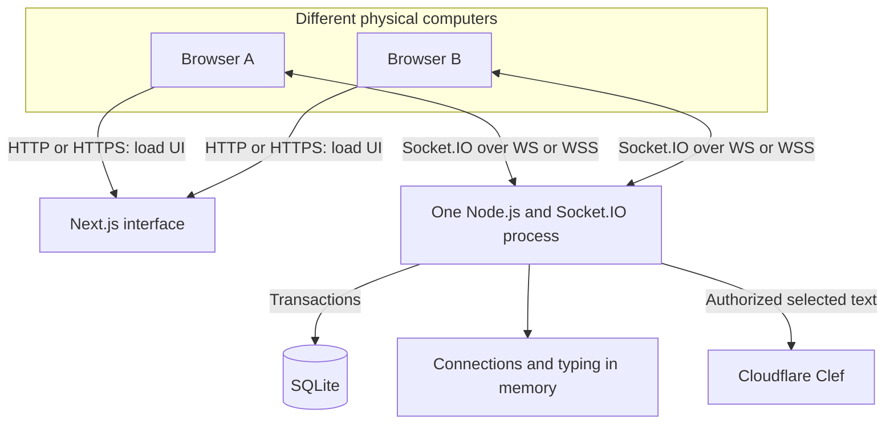

# System architecture

Talkmato has separate Next.js and Node.js applications. Next.js serves the browser interface. One Node.js process owns Socket.IO, authentication, room handlers, and SQLite. The browser connects directly to that backend. Next.js does not relay chat.

## Network protocols

| Layer | Role in Talkmato |
| --- | --- |
| HTTP | Serves UI/assets and exchanges the session cookie through `/session`. The backend also handles the WebSocket upgrade. |
| Socket.IO / Engine.IO | Names events and associates acknowledgements with commands. Both ends use matching Socket.IO libraries. |
| WebSocket | Carries bidirectional chat traffic. It is the only enabled Socket.IO transport. |
| TCP | Provides an ordered byte stream for each connection. A new connection does not establish account identity. |
| IP | Addresses the shared backend across physical computers. |
| TLS | Protects public HTTPS/WSS traffic, including credentials. Local HTTP/WS is for trusted development with disposable accounts. |

JSON is the payload format. SQLite is an embedded file, not a network service. The event endpoint uses `/socket.io/` and the default namespace `/`. Native `WebSocket.send` does not implement the Socket.IO event protocol.

## Source entry points

| Module | Responsibility |
| --- | --- |
| [Browser page](../frontend/src/app/page.tsx) and [ChatApp](../frontend/src/components/feature/chat/chat-app.tsx) | Compose the account gate and workspace. |
| [useAccountAuth](../frontend/src/components/feature/auth/use-account-auth.ts) and [AuthGate](../frontend/src/components/feature/auth/auth-gate.tsx) | Own the single socket, live identity, display cache, and guarded commands. |
| [ChatWorkspace](../frontend/src/components/feature/chat/chat-workspace.tsx) and [useRoomHistory](../frontend/src/components/feature/chat/use-room-history.ts) | Present conversations and synchronize paginated history. |
| [Server](../backend/src/server.ts) | Configure HTTP, session cookies, Socket.IO, storage, and feature handlers. |
| [Authentication](../backend/src/features/auth/auth-handlers.ts) | Verify Argon2id credentials, bind socket identity, restore sessions, and publish presence. |
| [Rooms](../backend/src/features/rooms/room-handlers.ts) | Open private rooms, create/join groups, send messages, and read history. |
| [Typing](../backend/src/features/typing/typing-handlers.ts) | Maintain expiring room-scoped status. |
| [Emoji effects](../backend/src/features/emoji/handlers.ts) | Authorize AI input, reuse/save results, and deliver to eligible readers. |
| [Storage](../backend/src/database/storage.ts) | Own the single `DatabaseSync` connection, schema initialization, queries, and transactions. |

## Boundaries and guarantees

A socket ID identifies a connection. A user ID identifies a persistent account. A session ID identifies an eight-hour login record. Browser JavaScript never receives the opaque session ID. [The protocol](websocket-protocol.md) defines authentication and HTTP cookie exchange.

One account has at most one active socket. Disconnect removes live identity, presence, and typing. It retains saved records. A separate browser display cache preserves the current view during temporary loss. It grants no permission to emit commands. [The UI lifecycle](ui-ux.md#account-and-connection-lifecycle) defines its clearing rules.

Handlers derive identity from the authenticated socket. Storage enforces membership and the permanent group join boundary. Socket.IO room subscriptions are delivery caches, not authorization. Durable changes commit before acknowledgement or broadcast. Manual message retries reuse the original `clientMessageId`. There are no automatic write retries.

The [data model](data-model.md) defines visibility and deletion. The [protocol sequences](websocket-protocol.md#message-and-history-path) show save, delivery, acknowledgement, and history merging.

## Runtime layout

Development uses Node 24.19.0 with built-in `node:sqlite`. Tests use in-memory or isolated temporary databases. One backend process uses the default Socket.IO adapter. Multiple workers require a separate shared-routing design.

Public delivery runs Next.js, one backend, and Caddy in Docker Compose on one GCE VM. Caddy exposes HTTPS/WSS on 80/443. SQLite and certificates use persistent volumes. Cloud Build publishes private images. The backend reads its AI token through the VM identity. [Deployment](deployment.md) contains the configuration and recovery reference.
