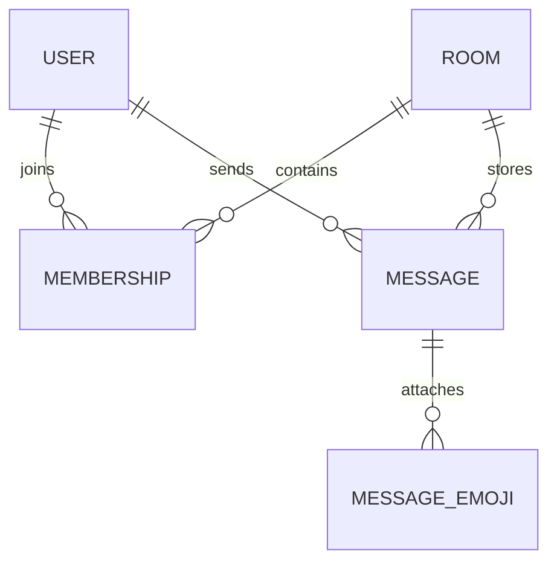

# Talkmato data model

Talkmato persists accounts, rooms, memberships, messages and AI emoji attachments in one SQLite database. Development uses Node `24.19.0` with `node:sqlite` / `DatabaseSync`; each developer’s ignored database file is `backend/data/talkmato.dev.sqlite`. Tests use `:memory:` and isolated temporary databases under ignored `work/`. `backend/src/database/storage.ts` owns database opening, schema initialization and transactions.

This document reflects full account registration/sign-in with eight-hour server sessions. The browser holds no resume token or password; its opaque session ID exists only in an HTTP-only cookie. See [architecture](architecture.md), [protocol](websocket-protocol.md), [implementation ownership](implementation-ownership.md) and the [core checklist](core-implementation-checklist.md).

## Durable entities

| Entity | Fields | Constraints |
| --- | --- | --- |
| User | `userId`, `name`, `canonicalName`, `passwordHash`, `createdAt` | `canonicalName` is globally unique, including offline users. Store an Argon2id password hash only. |
| Room | `roomId`, `kind`, optional group `name`, optional `privatePairKey` | `kind` is `private` or `group`; canonical private pair key is unique. |
| Membership | `roomId`, `userId`, `visibleFromSeq`, `joinedAt` | One membership per room/user; group creator is initial member; self-join only. |
| Message | `seq`, `messageId`, `roomId`, `senderId`, `clientMessageId`, `text`, `sentAt` | Server assigns monotonic sequence/time/sender; unique `(senderId, clientMessageId)`. |
| MessageEmoji | `emojiId`, `messageId`, `emoji`, `createdAt` | Storage transactions save only the first result per message. The existing unique `(messageId, emoji)` schema preserves legacy multi-emoji messages; internal `seq` orders attachments. |
| LoginSession | opaque `sessionId`, `userId`, `expiresAt`, `createdAt` | Server-only eight-hour session; its ID is sent only in an HTTP-only cookie. |

All IDs except `seq` are opaque strings. Times use UTC ISO 8601. Keep `seq` in JavaScript’s safe-integer range. Socket IDs, online status and typing state are runtime-only and never stored as durable identity.

## Required schema constraints and indexes

- `users.canonicalName` is unique.
- `rooms.privatePairKey` is unique when present.
- `memberships(roomId, userId)` is unique.
- `messages(senderId, clientMessageId)` is unique.
- `message_emojis(messageId, emoji)` is unique; its message foreign key prevents orphaned attachments. Schema initialization adds the table to existing databases without replacing history.
- Index `messages(roomId, seq)` for history pagination.
- Foreign keys are enabled and protect related records.
- Generated `.sqlite`, `-wal` and `-shm` files are ignored by Git; `schema.sql` and reset/migration scripts are committed.

## Authentication and runtime state

`auth.register` atomically reserves the canonical name, writes an Argon2id password hash, and authenticates the current socket only after the write succeeds. `auth.login` verifies the stored hash and binds the account to the current socket. The browser then exchanges that authenticated socket ID for an eight-hour HTTP-only session cookie; the opaque session ID is never returned in a DTO or saved in browser JavaScript. Passwords are not saved in browser storage, database logs, DTOs or source control.

`activeSocketByUserId` is runtime state. Only one active socket is allowed for an account; a second login gets `SESSION_IN_USE`. Disconnect clears live authentication/presence and typing, but does not delete durable data. An unexpired cookie session may restore a later Socket.IO connection; sign-out deletes that session and clears the cookie.

Account deletion is a durable tombstone, not a foreign-key-breaking row deletion. It revokes sessions, clears credentials, marks the user deleted and releases the canonical name. Queries for public users/group members exclude tombstones; message history resolves a deleted sender as `<Unknown>`. A remaining private-chat peer also sees `<Unknown>`. A newly registered account with the former name receives a new opaque user ID and no old history.

## Transactions and visibility

- Private-room creation inserts the unique pair room and both memberships in one transaction. Reopening returns the existing room.
- Group creation inserts only the creator as a member.
- On a first group join, write `visibleFromSeq = current maximum message seq + 1` in the join transaction. Repeated join or future sign-in never changes it.
- Every room/history/message/typing/AI request derives the actor from the authenticated socket, then checks persisted membership. Never trust a client-supplied sender ID, membership claim or history cursor as permission.
- Group history/message visibility requires `message.seq >= membership.visibleFromSeq`. Private participants may see all messages in their private room.
- `room.send` inserts the message before acknowledgement or live delivery. An identical retry returns the existing message without another insert/broadcast; reusing the key for different room/text returns `CLIENT_MESSAGE_ID_CONFLICT`.

## Public DTOs

| DTO | Fields |
| --- | --- |
| User | `userId`, `name`, `online: boolean` |
| PrivateRoom | `roomId`, `kind: "private"`, `members: User[2]` |
| Group | `roomId`, `kind: "group"`, `name`, `members: User[]` |
| Message | `seq`, `messageId`, `clientMessageId`, `roomId`, `senderId`, `senderName`, `text`, `sentAt`, `emojis: MessageEmoji[]` |
| MessageEmoji | `emojiId`, `emoji`, `createdAt` |
| AccountSnapshot | `self: User`, `users: User[]`, `groups: Group[]`, `privateRooms: PrivateRoom[]` |
| HistoryPage | `roomId`, `messages: Message[]`, `nextBeforeSeq: number or null`, `highWatermarkSeq: number` |

`users.snapshot` includes authenticated online users only, including self. Group and private member details include offline users. Password hashes, raw passwords, socket IDs, private-room lists and message history are never returned to unrelated users.

## History synchronization

`room.history` returns the newest 50 accessible messages by default (maximum 100), or older messages before an exclusive `beforeSeq`. Pages are ascending by `seq`; `nextBeforeSeq` is the oldest returned sequence only when another accessible older page exists. `highWatermarkSeq` is the largest accessible room sequence at the query snapshot.

On successful sign-in, replace public/authorized room metadata. Keep an authorized selected room, request fresh history, and merge concurrent live messages by `messageId`/`seq`. Never deduplicate messages by text. The UI must remain read-only while unauthenticated or disconnected.

## Transient and AI data

Typing is runtime-only: room/user/short-expiry state, cleared on send, empty draft, room switch, logout, disconnect or expiry. It is not persisted or replayed.

AI emoji attachments are durable. Before returning a saved result or sending text to a provider, verify message visibility under the membership/history rules. Existing results return without another provider call. For a new result, send only message text and the allow-list; recheck identity and visibility afterward, then commit the first attachment before acknowledgement or delivery. Per-message in-flight exclusion and the storage transaction prevent a second selection. Emit only to authenticated members whose join boundary permits the message. History returns saved attachments only with authorized messages. Existing multi-emoji data is preserved. Firework animation and local replay state remain transient browser state.
