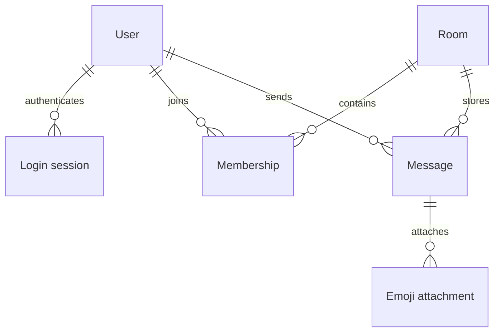

# Data model and visibility

[Storage](../backend/src/database/storage.ts) owns one built-in `node:sqlite` / `DatabaseSync` connection. [schema.sql](../backend/src/database/schema.sql) defines the tables and constraints. Storage initialization handles compatible additions. There are no separate committed reset or migration scripts.

## Durable records

The names below use the internal TypeScript form. SQL uses snake_case. Public response shapes belong to [the protocol](websocket-protocol.md#public-data).

| Record | Main fields and constraints |
| --- | --- |
| User | `userId`, `name`, `canonicalName`, Argon2id `passwordHash`, `createdAt`, optional `deletedAt`. Canonical names are unique, including offline accounts. |
| LoginSession | Opaque `sessionId`, `userId`, `createdAt`, `expiresAt`. The lifetime is eight hours. The ID travels only in an HTTP-only cookie. |
| Room | `roomId`, `kind`, `createdAt`, group `name` or unique `privatePairKey`. A private pair has one room. |
| Membership | `(roomId, userId)` primary key, `visibleFromSeq`, `joinedAt`. The first group join permanently sets visibility. |
| Message | Global `seq`, unique `messageId`, `roomId`, `senderId`, `clientMessageId`, `text`, `sentAt`. `(senderId, clientMessageId)` is unique. |
| MessageEmoji | Internal `seq`, unique `emojiId`, `messageId`, `emoji`, `createdAt`. `(messageId, emoji)` is unique. The current write path saves the first result only and preserves legacy multi-emoji records. |

IDs are opaque strings except numeric sequences. Times use UTC ISO 8601. Message sequences stay within JavaScript's safe-integer range. Foreign keys protect relationships. `messages(room_id, seq)` supports room-history queries. `login_sessions(expires_at)` supports session lookup/cleanup.

## Authorization and transactions

Private-room creation writes the pair room and both memberships in one transaction. A new group writes only its creator's membership. Others join themselves.

The first group join records `visibleFromSeq = current maximum message seq + 1` in the same transaction. The maximum is global across the database. Repeated joins and later sign-ins retain the original boundary.

Every history, send, typing, and AI request checks persisted membership. Group history and selected AI messages also require `message.seq >= membership.visibleFromSeq`. Private participants can read all saved messages in their room. Client IDs, cursors, and delivery subscriptions do not grant access.

A new message commits before delivery or success acknowledgement. An identical retry returns the saved message without another insert or broadcast. Reusing its key for another room/text returns `CLIENT_MESSAGE_ID_CONFLICT`.

## Deletion and lifetime

Account deletion writes a tombstone, revokes its sessions, clears credentials, and releases its canonical name. It does not remove messages. Public group-member queries omit the deleted account. Messages and the remaining private peer display `<Unknown>`. A new account with the former name gets a new user ID and no old history.

SQLite retains accounts, sessions, rooms, memberships, messages, and emoji attachments across restart when its file is persistent. Socket IDs, presence, typing, drafts, selected-room state, and firework replay state are temporary. The [UI reference](ui-ux.md) distinguishes its display cache from authenticated identity.

Development stores an ignored file at `backend/data/talkmato.dev.sqlite`. Tests use `:memory:` or isolated files under ignored `work/`. Generated SQLite, WAL, and SHM files stay outside Git. Public delivery uses a persistent volume and the schema-change/backup safeguards in [deployment](deployment.md).
