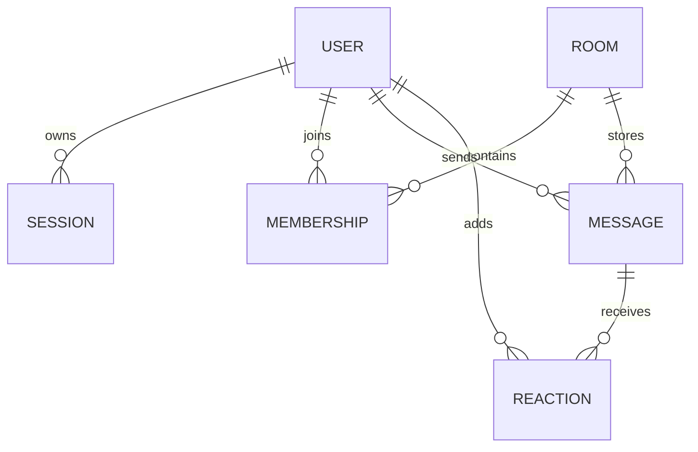

# Talkmato data model

The current lifecycle preserves identity, room membership, messages and tomato reactions across reconnect and targets backend-restart durability. It supersedes the earlier memory-only design. SQLite on persistent storage is the proposed single-process default; the driver/cloud provider remain unselected. See [architecture](architecture.md), [protocol](websocket-protocol.md) and [UI flows](ui-ux.md).

## Durable entities and relationships

| Entity | Fields | Constraints |
| --- | --- | --- |
| User | `userId`, `name`, `canonicalName`, `createdAt` | Globally unique canonical name, including offline users; stable ID across resume |
| Session | `sessionId`, `userId`, `tokenHash`, `expiresAt` | Random opaque token issued to that browser; store hash only; proposed 30-day inactivity expiry renewed on valid resume |
| Room | `roomId`, `kind`, optional group `name`, optional `privatePairKey` | Private pair key is unique and structured/canonicalized; exactly two private participants |
| Membership | `roomId`, `userId`, `visibleFromSeq`, `joinedAt` | Unique room/user; persists when offline; creator-only initial group; self-join only |
| Message | `seq`, `messageId`, `roomId`, `senderId`, `clientMessageId`, `text`, `sentAt`, `reactionVersion` | Server-generated monotonic global message `seq`, opaque unique message ID; unique `(senderId, clientMessageId)` |
| Reaction | `messageId`, `userId`, `emoji: "tomato"` | Unique message/user/emoji; desired enabled state rather than counter increments |

All IDs except `seq` are opaque strings. Times use UTC ISO 8601. Sequence numbers and reaction versions must serialize within JavaScript's safe integer range. Messages/reactions are durable; socket IDs and transport objects are not. No implicit delete on disconnect, restart, no online members or token expiry. Explicit removal/retention policy is a later decision.

## Transactions and visibility

- Registration atomically reserves the canonical name, creates User and Session, and returns the raw token only to its owner. Tokens are not URLs, names or transport IDs. Keep local database files, raw tokens and real chat content out of source control.
- Store the browser token in localStorage for same-browser/origin refresh recovery. Treat it as a bearer credential, use HTTPS/WSS publicly, render text safely and store only its hash server-side. No password or cross-device recovery is implied. Missing/expired token does not authorize reclaiming another user's name/history.
- Private creation inserts a unique pair room and its two memberships together. Repeated opens return that room. A new private room starts with an online peer from the list; an existing room may be used while its other member is offline.
- Group creation inserts only the creator. First join captures `visibleFromSeq = current maximum message seq + 1` in the same ordered write transaction. A repeated join or reconnect leaves this boundary unchanged. Private participants can see all messages of their private room.
- Every message/history/reaction operation checks the authenticated user and persisted membership. Group message visibility requires `message.seq >= membership.visibleFromSeq`; current membership alone cannot expose pre-join messages. Do not trust client-supplied sender, membership or history cursor as permission.
- Sending inserts the message and deduplication key in one transaction before acknowledgement/live delivery. Retrying the same sender/clientMessageId with identical room/text returns the existing Message without a second insert or broadcast. Reusing that key for different content returns `CLIENT_MESSAGE_ID_CONFLICT`.
- Reaction mutations increment that Message's `reactionVersion` in the same transaction as the unique reaction row change. No-op repeat desired state keeps the version. Only members allowed to read the target message can react or receive its update.

## Runtime-only state

| State | Ownership and lifetime |
| --- | --- |
| Socket.IO registry | Live transports and library channel membership; lost on disconnect/restart |
| `activeSocketByUserId` | One current socket per authenticated user; never persist socket ID as identity |
| Presence | Derived from active bindings; after backend startup everyone is offline until authenticated resume |
| Typing | Room/user and short expiry; clear on disconnect/send/room switch/expiry; never persist or replay |
| Delivery channels | `registered` for authenticated online users, `room:<roomId>` for connected members; rebuild from database after resume |

Enforce one active socket per identity. A second active socket gets `SESSION_IN_USE`; delayed disconnect cleanup must compare the socket ID before removing presence so it cannot erase a later valid binding. Disconnect removes only runtime entries; it does not revoke the token or remove memberships. Public group directory reads persistent members, not Socket.IO's internal room lists.

## Public DTOs

| DTO | Fields |
| --- | --- |
| User | `userId`, `name`, `online: boolean` |
| PrivateRoom | `roomId`, `kind: "private"`, `members: User[2]` |
| Group | `roomId`, `kind: "group"`, `name`, `members: User[]` |
| Message | `seq`, `messageId`, `clientMessageId`, `roomId`, `senderId`, `senderName`, `text`, `sentAt`, `reaction: ReactionSummary` |
| ReactionSummary | `emoji: "tomato"`, `userIds: string[]`, `version: number` |
| SessionSnapshot | `self: User`, `users: User[]`, `groups: Group[]`, `privateRooms: PrivateRoom[]` |
| HistoryPage | `roomId`, `messages: Message[]`, `nextBeforeSeq: number or null`, `highWatermarkSeq: number` |

DTO fields are required and arrays are empty when appropriate. `users`/`users.snapshot` contain online users only, including self. Group/private `members` include offline users with their names so member lists do not depend on the online directory. This replaces the old `memberIds`-only public room shape. Raw tokens appear only in the owner's registration acknowledgement, not snapshots, history, logs or other-user events.

## History loading and reconnect synchronization

`room.history` checks visibility and queries the proposed latest 50 accessible messages (maximum 100 requested), or older messages with exclusive `beforeSeq`. Return each page in ascending sequence order; `nextBeforeSeq` is the oldest returned seq if another accessible page exists, else null. `highWatermarkSeq` is the largest accessible room message seq at the query snapshot, or 0. Use an indexed `(roomId, seq)` query, not an unbounded history response.

On successful resume replace directories and authorized room metadata. Keep the selected room if still authorized; retain the offline read-only view until the fresh history query starts, then replace its loaded window with persisted results and merge concurrent live messages by `messageId`/`seq`. Older history remains available through Load older; do not claim all history was downloaded at once. Store live events arriving during loading until merging completes.

When snapshot/history and live reaction updates overlap, apply the higher `reaction.version` per message; a late page cannot overwrite a newer reaction. Render a confirmed own message using `clientMessageId` to reconcile its pending/unknown item. Never deduplicate by text. Invalid resume clears protected UI caches and returns to entry; temporary transport loss does not. Drafts stay in tab memory but need not survive refresh.

## Requirements and pending decisions

Unique names and online users cover R3–R4; room IDs and isolated UI views cover R5–R6; private memberships cover R7; creator-only creation, public persistent member lists and self-join cover R8–R10; group authorization and join-history boundaries cover R11. Persistent history and session resume are project enhancements, not newly invented assignment requirements.

Select database driver, migrations/backup approach, final retention policy and cloud persistent storage before implementation/deployment. AI behavior is provisional; stored messages do not automatically authorize sending all history to an AI provider.
