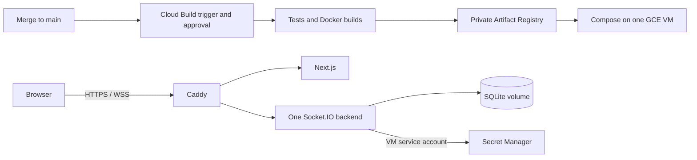

# Cloud Build delivery to Compute Engine

GitHub Actions runs PR checks. A Google Cloud Build trigger for `main` runs the release tests, builds both Docker images, pushes them to a private Artifact Registry repository, and updates Docker Compose on the existing Compute Engine VM through IAP/OS Login. Caddy provides HTTPS/WSS. The backend reads its AI token directly from Secret Manager at startup using the VM identity.

This repository contains deployment configuration, not a verified live deployment. The user reports that the GCP project, network, subnet, and firewall rules exist. Cloud setup, the GitHub connection/trigger, IAM, private registry pulls, Secret Manager access, DNS, and the public demonstration remain unverified. Account, cloud, privileged host, and secret-entry changes require separate owner authorization. No infrastructure is created by `cloudbuild.yaml`.

## Runtime and configuration



Only Caddy publishes ports 80/443. The backend and frontend use the Docker network, and Next.js does not relay chat. App images use Node 24.19.0, run as the unprivileged `node` user, and are built in Cloud Build rather than on the small VM. The backend compilation retains non-TypeScript runtime assets, including the SQL schema and any external catalog data.

The Compose project name stays `talkmato`. Volumes `talkmato_chat_data`, `talkmato_caddy_data`, and `talkmato_caddy_config` survive container replacement. SQLite remains at `/var/lib/talkmato/talkmato.sqlite` inside its volume. Volume storage is not a backup and does not survive loss of the backing VM disk.

Each release has a non-secret `.env` containing image digests, the Cloudflare account ID, and a pinned Secret Manager resource name. Compose passes those references to the backend. It does not use `/etc/talkmato/backend.env` or carry an AI token. Do not print resolved environment configuration; use `docker compose config --quiet` for validation.

When a secret version is configured, the backend obtains a short-lived Google token from the GCE metadata server, accesses that exact Secret Manager version over HTTPS, and retains the decoded AI token in memory. Calls share a five-second timeout and reject redirects. No credential file, downloaded service-account key, build-time AI token, or Google SDK dependency is needed. Retrieval failure disables AI and emits only a generic startup warning; core chat remains available. No configured secret means local startup makes no Google requests and retains the existing private environment-token development flow.

## One-time owner setup

Merge feature PR #6 first, then retarget delivery PR #7 to `main` before merging it. Create the Cloud Build trigger disabled and enable it only after the remaining setup is verified. Keep any old GitHub Delivery workflow disabled during migration. Existing cloud resources and old credentials are not deleted by this change.

### Project and services

Use project `talkmato` and region `asia-southeast1`. Enable Cloud Build, Artifact Registry, Secret Manager, Compute Engine, IAP, OS Login, IAM, Cloud Logging, and Cloud Resource Manager APIs as needed. Use the console's guided Cloud Build GitHub connection setup; its managed service agent may require access to its own GitHub connection secrets. Those connection credentials are separate from the app's AI secret.

Create a private Docker Artifact Registry repository named `talkmato` in `asia-southeast1`. Release images are:

```text
asia-southeast1-docker.pkg.dev/talkmato/talkmato/backend
asia-southeast1-docker.pkg.dev/talkmato/talkmato/frontend
```

Keep image digests used by the active and previous releases when setting retention policies. No GHCR publication, public image visibility, GitHub registry token, or GitHub-to-GCP federation provider is used by the new delivery flow.

### Identities and permissions

Create two dedicated service accounts. Use resource-level bindings where supported; avoid Editor or Owner grants.

| Identity | Required access |
| --- | --- |
| `talkmato-build` | Artifact Registry Writer on the app repository; Logs Writer on the project; Compute Viewer; OS Admin Login on the app VM; IAP Tunnel Resource Accessor for that VM restricted to destination port 22; Service Account User on `talkmato-runtime` for SSH into a VM with that attached account |
| `talkmato-runtime` | Artifact Registry Reader on the app repository; Secret Manager Secret Accessor on the specific AI secret |

Select `talkmato-build@talkmato.iam.gserviceaccount.com` explicitly on the trigger. Trigger settings override the build config's `serviceAccount` field. The person configuring the trigger needs permission to act as this account; the person approving builds needs Cloud Build Approver. The build's custom service account writes logs to Cloud Logging through `CLOUD_LOGGING_ONLY`.

Cloud Build does not request the AI secret payload. Deployment can run sudo on the VM and act as its runtime identity, so deployment code and trigger editors are privileged. The VM identity is shared by workloads on that VM; this design does not provide per-container IAM isolation.

### VM, network, and DNS

Create or verify VM `talkmato` in `asia-southeast1-b`: Ubuntu 24.04 AMD64, `e2-small`, 50 GiB balanced disk, a reserved public IPv4, and tag `talkmato`. Use the existing reviewed custom network/subnet (`talkmato-net`, `talkmato-sg`, `10.42.0.0/24`). Enable OS Login, block project-wide SSH keys, enable deletion protection, and retain the boot disk on VM deletion.

Attach `talkmato-runtime` to the VM with the `cloud-platform` OAuth access scope. IAM limits its actual permissions. For an existing VM, changing its attached account/scopes may require a stop/start and owner approval. Both Secret Manager and private registry authentication depend on this identity.

Allow inbound TCP 80/443 publicly, and TCP 22 only from IAP's `35.235.240.0/20`. Keep 3000/8080 closed. Point a DNS-only A record for `talkmato.azther0z.online` to the reserved IPv4 after inspecting existing A/AAAA records. Caddy requires reachable ports 80/443 and correct DNS for automatic public HTTPS.

Install Docker Engine, the Compose plugin, Python 3, and the Google Cloud CLI using their official Ubuntu instructions. On the approved VM, enable Docker and configure the registry helper **for root**, since deployment uses sudo:

```bash
sudo systemctl enable --now docker
sudo gcloud auth configure-docker asia-southeast1-docker.pkg.dev --quiet
sudo install -d -m 0755 /srv/talkmato/releases
sudo install -d -m 0700 /var/backups/talkmato
sudo docker compose version
```

The Docker helper obtains short-lived credentials from the attached VM identity; do not run an interactive user login on the VM or install a JSON key. No manual AI-token file or editor step is required. Review migration of any old host SQLite database before starting: activation refuses unmanaged data instead of silently creating a new history store.

### AI secret

Create a Secret Manager secret, for example `talkmato-cloudflare-token`. Enter the actual Cloudflare Workers AI token privately through the Google Cloud console. Give only the runtime identity secret-access permission on that secret. Do not paste the token into chat, source, trigger substitutions, Cloud Build environment variables, Docker build arguments, or logs.

Record a numeric version resource such as `projects/talkmato/secrets/talkmato-cloudflare-token/versions/1`. The backend intentionally rejects `latest`, aliases, and arbitrary URLs. The Cloudflare account ID is ordinary server configuration, not the API token.

To rotate: add a secret version, update the trigger's non-secret version reference, and run a reviewed release. A changed reference recreates the backend, which fetches the new value at startup. Pinning allows code/config rollback while the old secret version remains enabled. Container restart fetches the same selected version; the app does not poll for secret changes. Keep both AI substitutions empty to deploy core chat without AI.

### GitHub connection and trigger

In Cloud Build, connect `Azther0z/computer-network-project` using the GitHub app and create a regional trigger with these settings:

| Setting | Value |
| --- | --- |
| Name / region | `talkmato-release` / `asia-southeast1` |
| Event / branch regex | Push to branch / `^main$` |
| Build config | Repository file `cloudbuild.yaml` |
| Service account | `talkmato-build@talkmato.iam.gserviceaccount.com` |
| Require approval | Enabled |
| Initial state | Disabled until setup is verified |

The committed defaults select the app VM, zone, registry region, and repository. Set these two optional, non-secret trigger substitutions together:

| Substitution | Value |
| --- | --- |
| `_CLOUDFLARE_ACCOUNT_ID` | Cloudflare account ID, or empty for core chat only |
| `_CLOUDFLARE_TOKEN_SECRET_VERSION` | Full numeric Secret Manager version resource, or empty |

Cloud Build approval gates the **whole release build before tests execute**. GitHub PR checks still run before merge. There is no second approval pause between the release build and VM activation. Leave `main` protected with PRs and the existing `Test, build, and validate` GitHub check. Do not attach the privileged release trigger to PRs or fork branches. Trigger creation/approval is console-managed; no extra trigger-management script is committed.

The old GitHub `production` environment, `GCP_WIF_PROVIDER`, `GCP_DEPLOY_SERVICE_ACCOUNT`, and `GCP_CICD_READY` variables are no longer consumed. Any cleanup of already-created IAM/federation or GHCR resources requires separate review.

## Delivery and recovery

1. GitHub CI runs backend type checks/tests and frontend tests/lint/build for PRs. It has no Google or registry write permissions.
2. A merge into `main` creates a pending Cloud Build run. Approve it in Cloud Build after setup. It repeats app checks, builds images with unique commit/build-ID tags, and pushes them before deployment.
3. The deploy step resolves registry digests and transfers only Compose, Caddy, image references, AI resource references, and a schema hash through IAP. OS Login SSH keys expire after 15 minutes. The first connection records the host key; subsequent connections require it.
4. Activation waits up to ten minutes for the host lock, then checks the current public GitHub `main` SHA. An outdated build is refused even if it waited behind a newer deployment. This uses the repository's public GitHub API without credentials; network/rate-limit failure stops deployment. It does not serialize all Cloud Build jobs globally.
5. Configuration lives at `/srv/talkmato/releases/COMMIT-BUILD_ID`, with stable Compose project/volume names. A changed SQL schema stops activation pending a reviewed migration. Before replacing an existing app, SQLite's online backup API creates a consistent, private host backup under `/var/backups/talkmato`.
6. Compose pulls the private images and waits for the app health checks. Failed activation restores the previous release's Compose configuration/images; a failed initial deployment stops the containers. Database volumes are retained and never restored automatically. The `current` symlink changes only after local health succeeds. Public HTTPS/WSS checks remain manual.

For a normal code rollback, revert via a PR and let a new `main` build deploy it. For urgent operator recovery, inspect a known healthy release, change into its directory, run `sudo docker compose up -d --wait --wait-timeout 120`, then point `/srv/talkmato/current` to it after health passes. Image rollback does not reverse database writes, and the referenced secret version must still be enabled.

After failed first activation, a data volume can exist while `current` is absent. Inspect the failed release and its database, recover using its compatible Compose config, and set `current` only after health passes. Do not remove volumes to bypass the unmanaged-data guard. Backups are local to the VM; arrange an approved off-host destination and restore rehearsal. Old releases/images/backups are not automatically pruned.

Restart policies recover exited containers when Docker starts; an unhealthy but running process is not restarted solely because of health status. Updates interrupt sockets briefly, and the app performs bounded reconnect. For acceptance, use two physical computers to check public WSS, login/cookie restoration, history after container restart, private/group visibility, AI with the runtime secret, and externally blocked ports 3000/8080. Neither PR checks nor container health establish those results.

Cloud Build execution, Artifact Registry storage/transfer, Secret Manager operations, VM/disk/IP, network traffic, and AI can incur charges. No automatic teardown is scheduled. The previously discussed November 6–13, 2026 Bangkok availability window still needs an exact teardown and data-export decision.

## References

- [Cloud Build GitHub triggers](https://docs.cloud.google.com/build/docs/automating-builds/github/build-repos-from-github)
- [Cloud Build approval](https://docs.cloud.google.com/build/docs/securing-builds/gate-builds-on-approval)
- [Cloud Build user-managed service accounts](https://docs.cloud.google.com/build/docs/securing-builds/configure-user-specified-service-accounts)
- [Cloud Build script environment mapping](https://docs.cloud.google.com/build/docs/configuring-builds/run-bash-scripts)
- [Docker Engine on Ubuntu](https://docs.docker.com/engine/install/ubuntu/)
- [Artifact Registry authentication](https://docs.cloud.google.com/artifact-registry/docs/docker/authentication)
- [Secret Manager access](https://docs.cloud.google.com/secret-manager/docs/access-secret-version)
- [Secret Manager best practices](https://docs.cloud.google.com/secret-manager/docs/best-practices)
