# GitHub delivery to Google Cloud

This runbook replaces the earlier manual Cloud Shell deployment route. GitHub Actions tests, builds, plans, applies, and deploys the exact merged revision. A one-time owner setup establishes remote state and GitHub trust. Its versioned script runs from an authenticated Linux administrator terminal; Cloud Shell is an optional place to run that setup.

The repository is `Azther0z/computer-network-project`, with production source on `main`. Its current public visibility supports GitHub environment reviewers without a paid GitHub plan. Repository configuration and GCP permissions still require the owner's explicit approval before setup.

## Delivery flow

```mermaid
flowchart LR
    PR[Pull request] --> CI[Tests, lint, build, IaC checks]
    CI --> Main[Merge into main]
    Main --> Release[Repeat checks and package exact SHA]
    Release --> Plan[Read-only GCP plan]
    Plan --> Review[Infrastructure reviewer if changes exist]
    Review --> Apply[Apply saved plan with state lock]
    Apply --> Gate[Production reviewer]
    Plan -->|No changes| Gate
    Gate --> IAP[Upload and activate release through IAP]
    IAP --> Health[HTTPS, WebSocket, and firewall checks]
```



Pull requests receive no Google credentials. The workflow does not use `pull_request_target`. It also rejects cloud delivery from branches other than `main`, forks, and older runs when `main` already advanced.

Actions are pinned to verified full commit SHAs. The build uses Ubuntu 24.04 and Node 24.19.0. It includes a Next.js standalone server, backend runtime dependencies, and the Node binary. The VM installs no npm dependencies and compiles no frontend code during delivery.

The GitHub artifact contains app code and runtime files only. It includes a source-commit manifest and file hashes. Private Terraform plans and logs are stored in GCS rather than public Actions artifacts.

## Scope, cost, and resources

The existing infrastructure approval covers the custom network, subnet, two firewall rules, static IPv4 address, and Singapore VM with its 50 GiB balanced disk. The user reports that the project and four network resources exist. Terraform imports those resources instead of recreating them.

The base estimate from November 6, 2026 is US$5.58 for 168 hours before traffic, AI, and tax. The user reports US$10 of AI Pro Cloud credit in Cloud Billing. Other eligible account usage can consume the same credit. Cloudflare AI charges and the AI Pro subscription price are separate.

CI/CD adds one private Standard GCS bucket, one identity pool/provider, three service accounts, one narrow bucket-metadata role, and scoped IAM grants. GCS object storage, object versions, and requests have metered charges. This small state/plan workload is additional to the VM estimate. Inspect Cloud Billing after setup.

No automatic deletion is scheduled. The intended availability window is November 6–13, 2026 in Bangkok. Exact teardown time, authorized data export, and removal of retained billable resources remain a later review.

## Identity and storage boundaries

Workload Identity Federation exchanges GitHub's identity for a short-lived Google token. The trust condition requires this repository's immutable repository and owner IDs, `refs/heads/main`, and `.github/workflows/deploy.yml`. Each Google identity is bound to its exact GitHub environment subject.

| Identity | Environment | Access |
| --- | --- | --- |
| `talkmato-tf-plan` | `gcp-plan` | Compute viewer; read app state; read/write private plans |
| `talkmato-tf-apply` | `gcp-infrastructure` | Compute instance and network administration; write app state; read plans; create private failure logs |
| `talkmato-deploy` | `production` | Compute viewer; OS Login administration; IAP tunneling restricted to SSH port 22 |

The apply identity cannot edit bootstrap IAM or read bootstrap state. The deploy identity has no state-bucket access and no project IAM administration. It can run sudo on the dedicated app VM through OS Login. Required environment review protects that privileged step.

The pipeline requests one-hour access tokens and does not create Google credential files or store service-account JSON keys. Google Cloud CLI creates an ephemeral SSH key on the hosted runner, with a fifteen-minute OS Login expiry. No permanent SSH key is stored in GitHub Secrets.

Before SSH, the runner obtains the host key through an authenticated IAP tunnel to the exact instance. Subsequent SSH and SCP require that key. Port 22 remains closed to the public internet. The VM itself has no attached Google service account.

The bucket is named `talkmato-tfstate-PROJECT_NUMBER`, in Singapore. It enforces public-access prevention, uniform IAM, and object versioning. Owner bootstrap state uses `state/bootstrap`; application state uses `state/app`. IAM conditions restrict CI object access to the required prefixes. Workspace listing reveals object names, not bootstrap-state contents.

Planning uses a read-only state identity with `-lock=false`. GitHub concurrency serializes the whole delivery flow. Apply uses the GCS state lock and refuses a stale saved plan. Do not run a second manual app apply alongside Actions.

## First merge and owner bootstrap

Keep `GCP_CICD_READY` unset or `false` while reviewing and merging the source. The first merge runs checks and builds a release but does not access GCP. Publish this work through a reviewed pull request; the previous remote revision does not include the uncommitted Saint feature or delivery files.

After approval, use a terminal with the Google Cloud CLI authenticated as the project owner. A normal persistent Cloud Shell session also works. Use a fresh clone of the reviewed `main` revision. Run the versioned bootstrap script:

```bash
git clone https://github.com/Azther0z/computer-network-project.git
cd computer-network-project
git switch main
bash infra/bootstrap/owner-bootstrap.sh
```

The script enables the required Google APIs. It creates the deterministic private state bucket if absent, enables versioning, initializes both remote backends, and prepares a bootstrap plan. The bucket is created before backend initialization because the backend requires an existing bucket. Terraform then imports and manages that bucket.

GCS initializes an empty state under a write lock. The owner performs that initial app-state creation, so the CI plan identity can remain read-only. This step creates no VM and imports no network resources.

Inspect the bootstrap plan before applying it. It contains the state bucket import, identity federation, three service accounts, API tracking, and the IAM grants described above. It does not create the VM, change DNS, grant GitHub project ownership, or attach an identity to the app VM.

Apply that reviewed bootstrap plan, then save its non-secret GitHub variables under ignored `work/`:

```bash
terraform -chdir=infra/bootstrap apply .state/bootstrap.tfplan
mkdir -p work
terraform -chdir=infra/bootstrap output -json github_variables > work/github-variables.json
```

If any earlier app state exists locally, stop and migrate it into `state/app` before enabling CI. Do not discard state or reimport already-managed production resources blindly. The current user report confirms network creation only; no app Terraform apply is verified.

## Configure GitHub once

Use the five non-secret values from `github_variables` with `deploy/configure-github.py`. Run it with an already authenticated GitHub CLI and repository-admin access. The script checks repository identity, public visibility, and that the reviewed workflow is on `main`.

Preview the configuration first:

```bash
python3 deploy/configure-github.py work/github-variables.json
```

The configuration creates three main-only environments. `gcp-infrastructure` and `production` require owner review. Self-review is allowed so the owner can approve a solo project run. `gcp-plan` needs no reviewer because it cannot modify compute resources or app state.

The script also configures five non-secret repository variables. Main branch protection requires the CI check and a pull request, including for admins. It requires no additional PR approval, so the owner can merge after checks. Existing conflicting environment or branch protections cause a stop rather than an overwrite.

After account-change and initial host-deployment approval, apply the configuration and enable the pipeline:

```bash
python3 deploy/configure-github.py work/github-variables.json --apply --enable-delivery
```

The script sets `GCP_CICD_READY=false` until all policies and variables are configured, then enables delivery. It does not dispatch a workflow. Allow several minutes for Google IAM propagation after bootstrap. Start Actions → Delivery → Run workflow on `main` for the first deployment. Later merges trigger the same delivery flow.

## First infrastructure and DNS

The first app plan must show four imports, three additions, zero changes, and zero deletions. The plan guard checks the exact approved machine, location, disk, firewall, metadata, and resource set. An unexpected update or replacement stops delivery.

Review the resource summary in Actions and the complete `plan.log` in the private GCS `plans/` directory. Approving `gcp-infrastructure` applies the exact saved plan after a SHA256 check. It imports the existing network resources and creates the VM, boot disk, and static IP. A matching plan uses the infrastructure approval already supplied.

The apply job reports the public IPv4. Before approving `production`, prepare the exact DNS change for review: a DNS-only A record for `talkmato.azther0z.online` pointing to that address. Inspect existing A and AAAA records before editing. The pipeline stops before host installation when DNS does not resolve directly and exclusively to the intended IPv4.

Routine later plans have no imports or changes. The apply job is skipped in that case. Production still requires review before activating a new app release.

## Host deployment and data

`deploy/install-release.sh` verifies the archive digest, commit, safe paths, symlinks, and every file hash. On the approved Ubuntu 24.04 x86-64 host, it installs Caddy and SQLite if absent and creates an unprivileged app account. Ubuntu's Caddy package can briefly start its default site during installation.

The script stores immutable releases under `/srv/talkmato/releases`. The `current` symlink selects the active release. SQLite remains at `/var/lib/talkmato/talkmato.sqlite`, outside every release. Frontend cache is the only writable release directory.

Before an update, the script compares schema hashes and creates a consistent private SQLite backup on the host. A changed schema stops delivery until a migration is reviewed. The backup uses SQLite's online backup mechanism, so WAL data is included. Host-local backups do not protect against disk loss. A private off-server destination and restore rehearsal remain required before the demonstration.

Activation changes the symlink and restarts the two systemd services. Local backend/frontend health failures restore the previous release and its service/proxy files. The database is retained and never automatically restored. A failed first installation stops the app services. Previous releases remain available; the script does not prune data or old releases.

Caddy provides HTTPS and proxies Socket.IO, session, and health paths to the single backend process. Next.js binds to loopback. Public smoke checks cover HTTPS, frontend content, an unauthenticated WebSocket handshake, and blocked ports 3000/8080. They create no accounts, messages, or AI calls.

A public smoke failure marks the delivery failed. It does not automatically roll back a locally healthy release because DNS or certificate issuance can cause that failure. Inspect the cause. For a code rollback, revert the source through a pull request and run normal delivery. Schema changes still need a migration review.

## Private AI configuration and demonstration

The pipeline never reads or writes real Clef credentials. The backend service optionally loads `/etc/talkmato/ai.env`, owned by root with mode 0600. The user enters the Cloudflare account ID and token privately on the server through an approved credential step. Keep that file outside releases and out of Git, workflow inputs, logs, and artifacts.

Core chat works without that file and returns a safe AI-unavailable error. Do not report the complete Saint feature as deployed until the private configuration and live default-catalog rehearsal pass. The original English/Thai evaluation remains documented in `docs/saint-ai.md`.

Two physical computers on different networks, session restoration, persisted history after restart, privacy checks, and a backup restore rehearsal remain public-deployment acceptance checks. CI and the unauthenticated public smoke do not prove those requirements.

## Validation and references

Local validation covers application tests, lint, the standalone build, Terraform formatting/provider schemas, workflow syntax, plan-policy safety cases, archive tampering cases, and mocked GitHub configuration. The extracted release can run locally without npm installation. Those results do not establish GCP IAM propagation, successful OS Login, first-host package installation, actual Terraform imports, or a deployed environment.

Use these primary references for the external behavior:

- [Google federation for deployment pipelines](https://docs.cloud.google.com/iam/docs/workload-identity-federation-with-deployment-pipelines)
- [Google GitHub authentication action](https://github.com/google-github-actions/auth)
- [GCS Terraform backend and locking](https://developer.hashicorp.com/terraform/language/backend/gcs)
- [GitHub deployment environments](https://docs.github.com/en/actions/how-tos/deploy/configure-and-manage-deployments/manage-environments)
- [Google IAP SSH access](https://docs.cloud.google.com/iap/docs/using-tcp-forwarding)
- [GCP VM pricing](https://cloud.google.com/products/compute/pricing/general-purpose)
- [GCP disk pricing](https://cloud.google.com/compute/disks-image-pricing)
- [GCP IPv4 pricing](https://cloud.google.com/vpc/network-pricing)
- [Cloud Storage pricing](https://cloud.google.com/storage/pricing)
