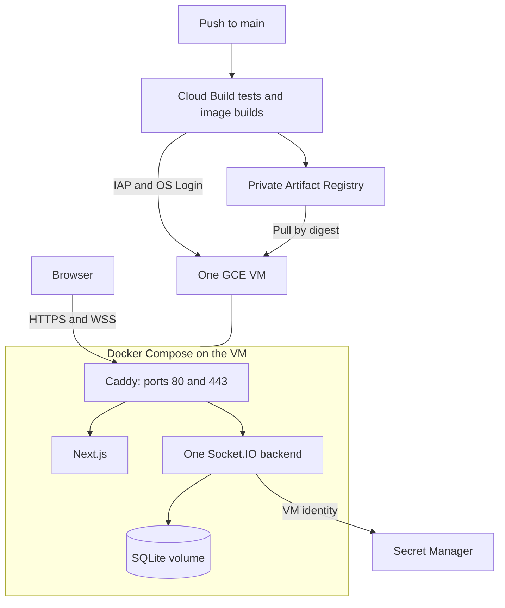

# Cloud Build and Compose operations

[cloudbuild.yaml](../cloudbuild.yaml) runs release checks, builds images, publishes to private Artifact Registry, and activates Compose on one GCE VM. [GitHub Actions](../.github/workflows/ci.yml) runs PR checks. [compose.yaml](../compose.yaml) and [Caddyfile](../deploy/Caddyfile) define the runtime.



## Configuration reference

| Item | Value |
| --- | --- |
| Project / region / zone | `talkmato` / `asia-southeast1` / `asia-southeast1-b` |
| VM | `talkmato`, Ubuntu 24.04 AMD64, `e2-small`, 50 GiB balanced disk |
| Network / subnet | `talkmato-net` / `talkmato-sg`, `10.42.0.0/24` |
| Public hostname | `talkmato.azther0z.online`, DNS-only A record to the reserved IPv4 |
| Registry | `asia-southeast1-docker.pkg.dev/talkmato/talkmato/{backend,frontend}` |
| Compose project | `talkmato` |
| Persistent volumes | `talkmato_chat_data`, `talkmato_caddy_data`, `talkmato_caddy_config` |
| Database in the backend | `/var/lib/talkmato/talkmato.sqlite` |
| Release / active link | `/srv/talkmato/releases/COMMIT-BUILD_ID` / `/srv/talkmato/current` |
| Local host backups | `/var/backups/talkmato`, private SQLite backups |

Caddy exposes only 80/443 and routes `/socket.io`, `/session`, and `/health` to the backend. Other requests go to Next.js. Ports 3000/8080 stay on the Docker network. SSH uses IAP's `35.235.240.0/20` range on port 22. The VM uses OS Login, blocked project-wide SSH keys, deletion protection, and a retained boot disk.

App images use Node 24.19.0 and the unprivileged `node` user. Backend images include the compiled SQL schema and emoji catalog. Release `.env` files contain image digests, the Cloudflare account ID, and the pinned secret reference. They contain no AI token. Validate privately with `docker compose config --quiet`, never by printing resolved configuration.

## Identities and trigger

| Identity | Access |
| --- | --- |
| `talkmato-build` | App-repository Artifact Registry Writer, project Logs Writer/Compute Viewer, VM OS Admin Login and port-22 IAP access, Service Account User on the runtime account. |
| `talkmato-runtime` | App-repository Artifact Registry Reader and Secret Accessor on the specific AI secret. |

The VM attaches `talkmato-runtime` with the `cloud-platform` scope. IAM limits its actual access. The root Docker registry helper uses that identity. Deployment code runs privileged commands and can act as the runtime identity. This VM does not provide per-container IAM isolation. No downloaded service-account keys or interactive VM user login are needed.

The `talkmato-release` trigger in `asia-southeast1` watches `^main$`, reads `cloudbuild.yaml`, and explicitly selects `talkmato-build`. Trigger settings override the YAML service account. Approval policy lives on the trigger, outside Git. When enabled, approval gates the whole build before tests. The YAML contains no second pause before activation. Do not attach this privileged trigger to PRs or fork branches.

The build needs Cloud Build, Artifact Registry, Compute, IAP, OS Login, IAM, Logging, Resource Manager, and Secret Manager services. Cloud Build's GitHub connection credentials are separate from the app's AI secret. The current flow does not use Terraform, GitHub-to-GCP federation, GHCR, or the old GitHub production-environment variables.

## AI credentials and rotation

Local development reads `CLOUDFLARE_ACCOUNT_ID` and `CLOUDFLARE_AUTH_TOKEN` privately from the backend process environment. GCE delivery uses these optional non-secret substitutions together:

| Substitution | Value |
| --- | --- |
| `_CLOUDFLARE_ACCOUNT_ID` | Cloudflare account ID |
| `_CLOUDFLARE_TOKEN_SECRET_VERSION` | `projects/PROJECT/secrets/SECRET/versions/NUMBER` |

Keep both empty for core chat without AI. Use a numeric enabled version, never `latest`, aliases, or arbitrary URLs. Enter the actual Workers AI token privately in Secret Manager. Grant access on that secret to the runtime identity. Builds do not read its payload.

At startup, the backend obtains a short-lived Google token from GCE metadata and reads the pinned secret over HTTPS. It retains the decoded AI token in memory. Retrieval uses a shared five-second deadline and rejects redirects. Failure disables AI with a generic warning while core chat continues. No configured secret means local startup makes no Google requests.

To rotate, add a secret version, change the trigger's version reference, and release. A changed reference recreates the backend. Restart reads the same pinned version. The app does not poll for changes. Keep the previous version enabled while a rollback can reference it.

## Release and recovery

Cloud Build repeats checks and builds images tagged with the commit/build ID. It resolves immutable digests and copies Compose, Caddy, image/AI references, and the schema hash through IAP. OS Login SSH keys expire after 15 minutes. Subsequent connections require the recorded host key.

Activation takes a host lock with a ten-minute wait. It then checks the public GitHub `main` SHA and rejects stale builds. GitHub API/network failure stops deployment. The lock serializes activation on the VM, not all Cloud Build jobs.

A changed schema hash stops activation for migration review. Before replacing an active release, SQLite's online backup API writes a consistent host backup. Activation validates Caddy and Compose, pulls images, waits for container health, then updates `current`. Streamed container commands disable interactive input so they cannot consume the remaining activation script.

Failed activation restores the previous Compose configuration/images. A failed first activation stops its containers. Database volumes remain intact and are never automatically restored. Health checks establish local service availability, not every external application behavior.

For ordinary code rollback, revert through a PR and release that new `main` revision. For urgent recovery, inspect a known compatible release on the VM. From its directory, run:

```sh
sudo docker compose up -d --wait --wait-timeout 120
```

After health succeeds, point `/srv/talkmato/current` to that release. Image rollback does not undo database writes. Its referenced secret version must still be enabled.

If a data volume exists without `current`, inspect its ownership and contents before recovery. The unmanaged-data guard refuses activation rather than silently replacing history. Do not remove volumes to bypass it. Recover with compatible Compose configuration and set `current` only after health passes.

Volumes are not backups. They depend on the VM disk. Host backups share that failure domain. Releases, images, and backups are not automatically pruned. Restart policies recover exited containers, but an unhealthy running container is not restarted solely for its health status. Resource usage incurs charges, and no teardown is scheduled by this repository.

## Provider references

[Cloud Build triggers](https://docs.cloud.google.com/build/docs/automating-builds/github/build-repos-from-github), [approval](https://docs.cloud.google.com/build/docs/securing-builds/gate-builds-on-approval), [service accounts](https://docs.cloud.google.com/build/docs/securing-builds/configure-user-specified-service-accounts), [Docker on Ubuntu](https://docs.docker.com/engine/install/ubuntu/), [registry authentication](https://docs.cloud.google.com/artifact-registry/docs/docker/authentication), and [Secret Manager access](https://docs.cloud.google.com/secret-manager/docs/access-secret-version).
