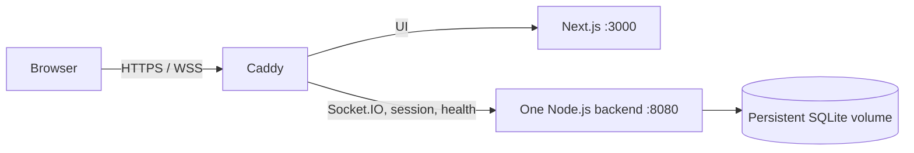

# Single-VM deployment with Docker Compose

GitHub Actions tests Talkmato, builds frontend/backend images, and publishes the images after application checks to GitHub Container Registry (GHCR). After production approval, it connects to the existing GCP VM through IAP and runs Docker Compose with the exact image digests. Infrastructure setup is a one-time owner task; Actions does not provision or change cloud resources.

This is deployment preparation, not evidence of a running public service. The user reports that the GCP project, network, subnet, and firewall rules exist. VM creation, identity setup, DNS, package visibility, and public acceptance checks still need verification. Do not enable delivery until the setup below is complete.

## Runtime



Only Caddy publishes host ports, 80 and 443. Containers find one another through Compose service names. Both app containers listen inside the Docker network; neither publishes a host port. Browsers still use socket.io-client against the single backend, and Next.js never relays chat.

The two Dockerfiles use Node 24.19.0. The backend image compiles TypeScript and includes its SQL schema, emoji catalog, and production dependencies, including native Argon2. The frontend image uses Next.js standalone output. Both app processes run as the image's unprivileged `node` user. Images are built in CI, not on the small VM.

`compose.yaml` fixes the project name to `talkmato`. Its volumes are `talkmato_chat_data`, `talkmato_caddy_data`, and `talkmato_caddy_config`. SQLite stays under `/var/lib/talkmato` inside the backend volume; certificate data survives Caddy replacement. Container replacement preserves these volumes. Volume storage is not a backup and does not protect against VM disk loss.

Real configuration lives only at `/etc/talkmato/backend.env` on the VM, readable by root. Compose injects it into the backend at runtime. AI configuration is optional for core chat. Never put real environment files in images, Git, workflow inputs, or URLs. Use `docker compose config --quiet` for validation; ordinary `config` output can disclose resolved environment values.

## One-time owner setup

Account, cloud, DNS, and privileged host changes require explicit owner approval. The workflow stays disabled while `GCP_CICD_READY` is unset or false. This repository change performs none of those external actions.

### VM and network

Use project `talkmato`, region `asia-southeast1`, and zone `asia-southeast1-b`. Inspect existing resources before creating anything. The previous proposal selected:

- Custom network `talkmato-net` and subnet `talkmato-sg` (`10.42.0.0/24`).
- VM `talkmato`: Ubuntu 24.04 AMD64, `e2-small`, 50 GiB balanced disk, and a reserved external IPv4.
- VM tag `talkmato`; inbound TCP 80/443 for the website, and TCP 22 from IAP's `35.235.240.0/20` range only.
- OS Login enabled, project-wide SSH keys blocked, VM deletion protection enabled, boot disk retained on VM deletion, and no attached Google service account.

Confirm these settings in GCP. Keep ports 3000 and 8080 closed. Inspect existing A/AAAA records, then configure a DNS-only A record for `talkmato.azther0z.online` pointing directly to the reserved IPv4. Remove or correct conflicting records only after review. DNS and reachable ports 80/443 are prerequisites for Caddy's automatic HTTPS.

Install Docker Engine and the Compose plugin using the official Ubuntu instructions. Enable Docker at boot. On the approved host, prepare the private configuration from the reviewed repository revision:

```bash
sudo systemctl enable --now docker
sudo install -d -m 0755 /srv/talkmato/releases /etc/talkmato
sudo install -d -m 0700 /var/backups/talkmato
sudo install -m 0600 deploy/backend.env.example /etc/talkmato/backend.env
sudoedit /etc/talkmato/backend.env
sudo docker compose version
```

Do not overwrite an existing environment file. Enter any optional Cloudflare account/token privately with the editor. The workflow never uploads, prints, or replaces this file. For an existing deployment, review its database and stop conflicting host services before adopting this layout. The workflow refuses an existing host database or Compose database volume without managed release metadata.

### GitHub-to-Google authentication

Follow Google's deployment-pipeline federation guide to create a Workload Identity Pool/provider and one service account, `talkmato-deploy`. Enable the Compute, IAP, OS Login, IAM, IAM Credentials, STS, and Cloud Resource Manager APIs as needed. No Terraform state bucket or plan/apply identities are required.

Use GitHub's issuer `https://token.actions.githubusercontent.com`. Map `google.subject` to `assertion.sub`. Restrict the provider with all of these claims, using the repository and owner's immutable numeric IDs from GitHub:

| Claim | Required value |
| --- | --- |
| `assertion.repository_id` | This repository's numeric ID |
| `assertion.repository_owner_id` | This owner's numeric ID |
| `assertion.ref` | `refs/heads/main` |
| `assertion.workflow_ref` | `Azther0z/computer-network-project/.github/workflows/deploy.yml@refs/heads/main` |

Allow `roles/iam.workloadIdentityUser` on `talkmato-deploy` only for the pool's exact subject `repo:Azther0z/computer-network-project:environment:production`.

The service account needs Compute viewer access, `roles/compute.osAdminLogin`, and `roles/iap.tunnelResourceAccessor` restricted to the app VM and destination port 22. Scope permissions to the app VM where supported. OS Admin Login permits sudo on this dedicated VM; production review protects that privilege. It needs no project IAM administration, network administration, or storage-bucket access. Do not create a service-account JSON key or permanent CI SSH key.

### GitHub configuration and first publication

Configure these non-secret repository variables:

| Variable | Value |
| --- | --- |
| `GCP_WIF_PROVIDER` | Full Workload Identity Provider resource name |
| `GCP_DEPLOY_SERVICE_ACCOUNT` | `talkmato-deploy` service-account email |
| `GCP_CICD_READY` | Keep `false` until setup is verified |

Create a `production` environment restricted to `main`, with required owner review. A solo owner may allow self-review. Protect `main` with the `Test, build, and validate` check and pull requests. PR jobs receive no Google authentication, and publishing runs only on `main`; the workflows do not use `pull_request_target`.

After the reviewed PR reaches `main`, Delivery runs checks and publishes these two packages even while cloud delivery is disabled:

- `ghcr.io/azther0z/computer-network-project-backend`
- `ghcr.io/azther0z/computer-network-project-frontend`

GHCR packages are initially private. Explicitly make both packages public before enabling VM deployment; public source code and runtime assets are their only contents. The workflow uses its built-in GitHub token to publish, and the VM pulls anonymously. Do not place registry credentials on the VM. Inspect the package contents and visibility first.

Set `GCP_CICD_READY=true` only after the VM, private configuration, DNS, permissions, environment protection, and public packages are ready. Run Actions → Delivery → Run workflow on `main`. Allow for IAM propagation. Later merges follow the same flow. Merge feature PR #6 first, then retarget delivery PR #7 to `main` before merging it.

## Routine delivery

1. CI runs the backend tests/type checks and frontend tests/lint, builds both production images, and validates Caddy configuration. It does not run the removed workflow/Compose validation or packaged HTTP/WebSocket checks.
2. Only a successful `main` run publishes those images. Unique tags identify the revision/run/attempt; deployment uses the registry digests, not mutable tags.
3. The production job requires approval and rejects an obsolete `main` revision. Its branch guard also covers manual runs, which can select another branch. Short-lived federation supplies a one-hour access token without Google credential files. The upload step uses gcloud's default first-connection host-key trust through IAP; later SCP/SSH connections require that recorded key. OS Login keys expire after 15 minutes.
4. The upload step transfers Compose, Caddy, image digests, and a schema hash. A separate activation step installs them at `/srv/talkmato/releases/COMMIT-RUN-ATTEMPT`, with no database or private configuration. Fixed project/volume names preserve data across release directories.
5. Before changing running services, activation refuses a changed SQL schema and makes a consistent SQLite online backup at `/var/backups/talkmato/before-RELEASE.sqlite`. A host lock and GitHub concurrency serialize deployments.
6. Compose pulls images and waits for the frontend/backend health checks. A failed activation restores the previous release's Compose configuration and images; a failed initial activation stops the containers. Database volumes are retained and never automatically restored. `/srv/talkmato/current` changes only after successful local health checks.
7. Public HTTPS and WebSocket verification is manual; the workflow has no public HTTPS probe.

Restart policies recover exited containers and start them when Docker restarts. An unhealthy but still-running process is reported by health checks; it is not automatically restarted merely because it is unhealthy. Updates briefly interrupt sockets, which use the app's bounded reconnect behavior. This is not a zero-downtime deployment.

All deployment commands and verification live in the two workflows. There is no `deploy.sh`, `smoke.mjs`, `.service` file, or custom app archive format.

## Recovery and acceptance

For code rollback, revert through a reviewed PR and deploy the resulting images. For urgent operator recovery, inspect a known healthy release under `/srv/talkmato/releases`, change into that directory, and run `sudo docker compose up -d --wait --wait-timeout 120`. After it passes, update `/srv/talkmato/current` to that release. Never print `.env` contents or resolved Compose configuration. Schema changes require a reviewed migration; rolling images back does not undo database writes.

Backups are private and local to the VM. Arrange an approved off-host backup destination and rehearse restoration before relying on durability. Restore only with the backend stopped and a compatible schema. Do not remove data volumes during routine deployment. Old releases, images, volumes, and backups are not automatically pruned; review retention and disk use before cleanup.

After a failed first activation, data volumes may exist while `current` is absent. Inspect the failed release and its database, recover with its compatible Compose configuration, then set `current` after health checks pass. Do not delete the volume to bypass the unmanaged-data guard.

Before claiming public deployment complete, use two physical computers to verify sign-in, public WSS, HTTP-only session restoration, private/group authorization, persistence after container restart, and optional live AI configuration. Check externally that ports 3000/8080 are unreachable. Application tests and Compose health checks do not prove these public browser and firewall requirements.

VM, disk, reserved IPv4, traffic, and any AI usage remain billable. No automatic teardown is scheduled. The previously discussed availability window is November 6–13, 2026 in Bangkok; exact teardown time, data export, and retained resources need later review. Removing Terraform files does not delete any cloud resources or state that may already exist.

## References

- [Docker Engine on Ubuntu](https://docs.docker.com/engine/install/ubuntu/)
- [Compose on a production server](https://docs.docker.com/compose/how-tos/production/)
- [Persistent Docker volumes](https://docs.docker.com/engine/storage/volumes/)
- [Caddy automatic HTTPS](https://caddyserver.com/docs/automatic-https)
- [Google deployment-pipeline federation](https://docs.cloud.google.com/iam/docs/workload-identity-federation-with-deployment-pipelines)
- [Google IAP SSH access](https://docs.cloud.google.com/compute/docs/connect/ssh-using-iap)
- [GHCR authentication and package visibility](https://docs.github.com/en/packages/working-with-a-github-packages-registry/working-with-the-container-registry)
