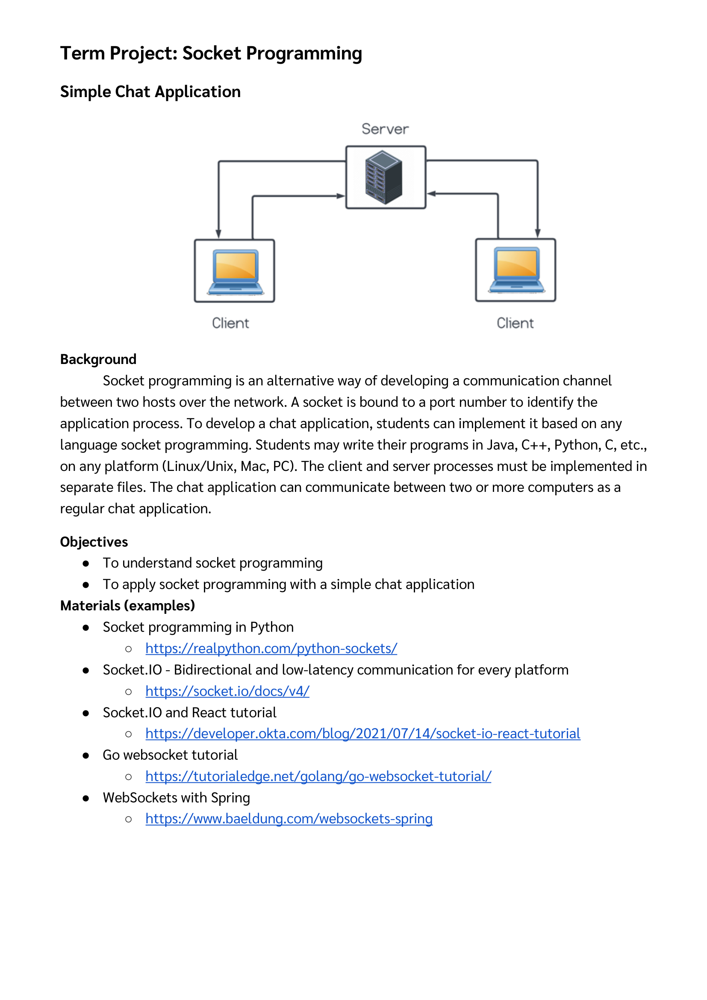
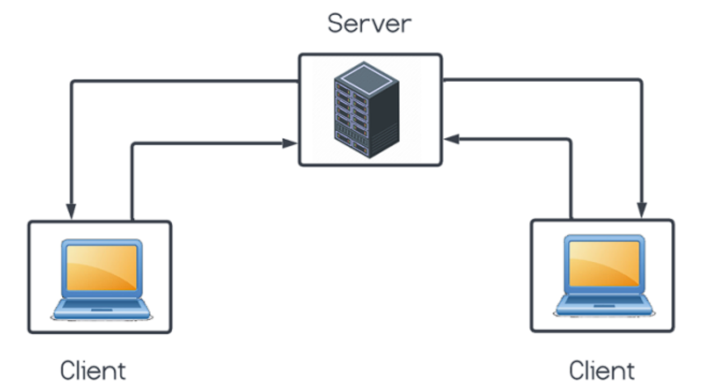
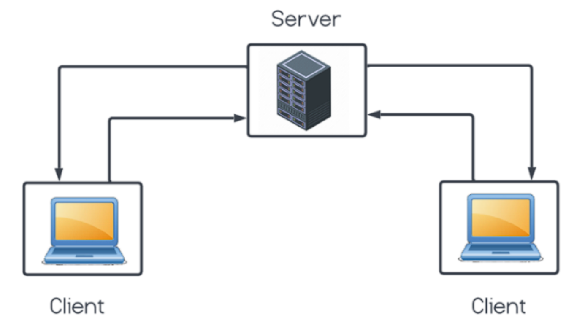
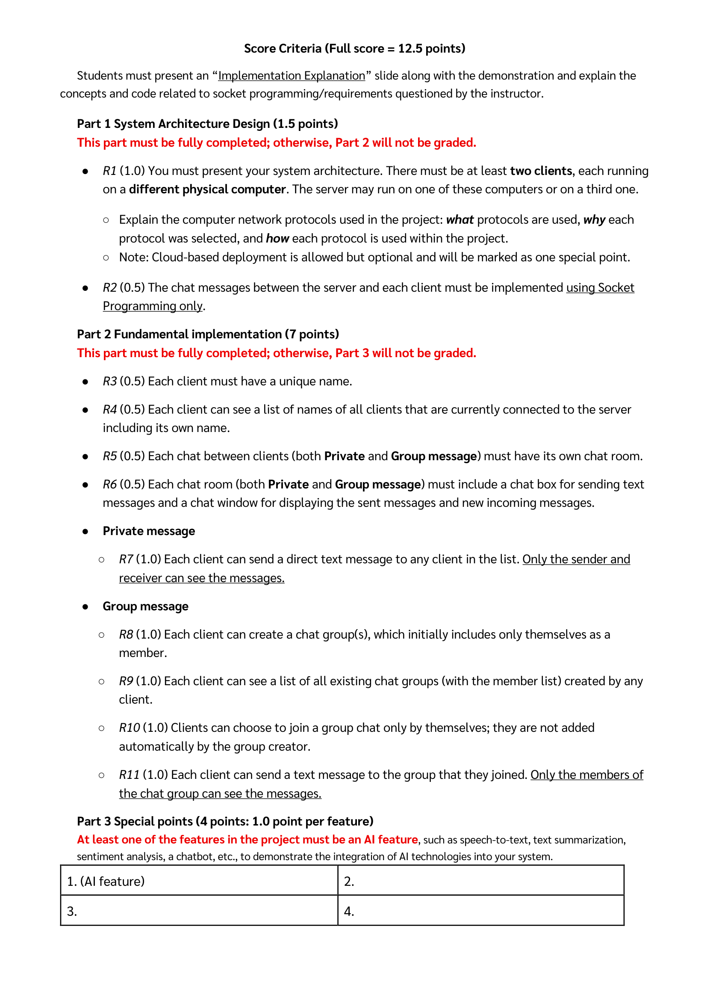

# Computer_Network_Term_Project___Socket_Programming-1047532-17880926607939.pdf

Original: [unchanged source PDF](../../sources/Computer_Network_Term_Project___Socket_Programming-1047532-17880926607939.pdf).

This is a page-oriented derivative. The original PDF remains authoritative.
Each page contains extracted source text, source visual evidence, and labeled visual notes.
All pages received direct visual review on 2026-11-01. No unreadable regions were found.

## Page 1

### Source text

```text
Term Project: Socket Programming

Simple Chat Application


Background
      Socket programming is an alternative way of developing a communication channel
between two hosts over the network. A socket is bound to a port number to identify the
application process. To develop a chat application, students can implement it based on any
language socket programming. Students may write their programs in Java, C++, Python, C, etc.,
on any platform (Linux/Unix, Mac, PC). The client and server processes must be implemented in
separate files. The chat application can communicate between two or more computers as a
regular chat application.

Objectives
  ●  To understand socket programming
  ●  To apply socket programming with a simple chat application
Materials (examples)
  ●  Socket programming in Python
       ○  https://realpython.com/python-sockets/
  ●  Socket.IO - Bidirectional and low-latency communication for every platform
       ○  https://socket.io/docs/v4/
  ●  Socket.IO and React tutorial
       ○  https://developer.okta.com/blog/2021/07/14/socket-io-react-tutorial
  ●  Go websocket tutorial
       ○  https://tutorialedge.net/golang/go-websocket-tutorial/
  ●  WebSockets with Spring
       ○  https://www.baeldung.com/websockets-spring
```

### Source visual evidence





Source crop — page 1, client/server diagram:



### Reconstruction (not source)

The diagram shows one server and two clients. Each client has one arrow toward the server and one arrow from the server. No direct client-to-client arrow is shown.

## Page 2

### Source text

```text
Score Criteria (Full score = 12.5 points)

   Students must present an “Implementation Explanation” slide along with the demonstration and explain the
concepts and code related to socket programming/requirements questioned by the instructor.

   Part 1 System Architecture Design (1.5 points)
   This part must be fully completed; otherwise, Part 2 will not be graded.

   ●  R1 (1.0) You must present your system architecture. There must be at least two clients, each running
      on a different physical computer. The server may run on one of these computers or on a third one.

      ○  Explain the computer network protocols used in the project: what protocols are used, why each
          protocol was selected, and how each protocol is used within the project.
      ○  Note: Cloud-based deployment is allowed but optional and will be marked as one special point.

   ●  R2 (0.5) The chat messages between the server and each client must be implemented using Socket
      Programming only.

   Part 2 Fundamental implementation (7 points)
   This part must be fully completed; otherwise, Part 3 will not be graded.

   ●  R3 (0.5) Each client must have a unique name.

   ●  R4 (0.5) Each client can see a list of names of all clients that are currently connected to the server
        including its own name.

   ●  R5 (0.5) Each chat between clients (both Private and Group message) must have its own chat room.

   ●  R6 (0.5) Each chat room (both Private and Group message) must include a chat box for sending text
       messages and a chat window for displaying the sent messages and new incoming messages.

   ●  Private message

     ○  R7 (1.0) Each client can send a direct text message to any client in the list. Only the sender and
           receiver can see the messages.

   ●  Group message

     ○  R8 (1.0) Each client can create a chat group(s), which initially includes only themselves as a
         member.

     ○  R9 (1.0) Each client can see a list of all existing chat groups (with the member list) created by any
            client.

     ○  R10 (1.0) Clients can choose to join a group chat only by themselves; they are not added
          automatically by the group creator.

     ○  R11 (1.0) Each client can send a text message to the group that they joined. Only the members of
          the chat group can see the messages.

   Part 3 Special points (4 points: 1.0 point per feature)
   At least one of the features in the project must be an AI feature, such as speech-to-text, text summarization,
   sentiment analysis, a chatbot, etc., to demonstrate the integration of AI technologies into your system.

 1. (AI feature)                                      2.

 3.                                                   4.
```

### Source visual evidence



### Reconstruction (not source)

The final table contains four feature slots. Only the first slot is labeled as an AI feature. The other three slots are blank.

| Upper left | Upper right |
| --- | --- |
| 1. (AI feature) | 2. |
| 3. | 4. |
