# Computer_Network_Term_Project___Socket_Programming___Implementation_Explanation-1047532-17880926752070.pdf

Original: [unchanged source PDF](../../sources/Computer_Network_Term_Project___Socket_Programming___Implementation_Explanation-1047532-17880926752070.pdf).

This is a page-oriented derivative. The original PDF remains authoritative.
Each page contains extracted source text, source visual evidence, and labeled visual notes.
All pages received direct visual review on 2026-11-01. No unreadable regions were found.

## Page 1

### Source text

```text
Term Project:
Socket Programming


                Group X
         6xxxxxxxx21 Name Surname
         6xxxxxxxx21 Name Surname
```

### Source visual evidence

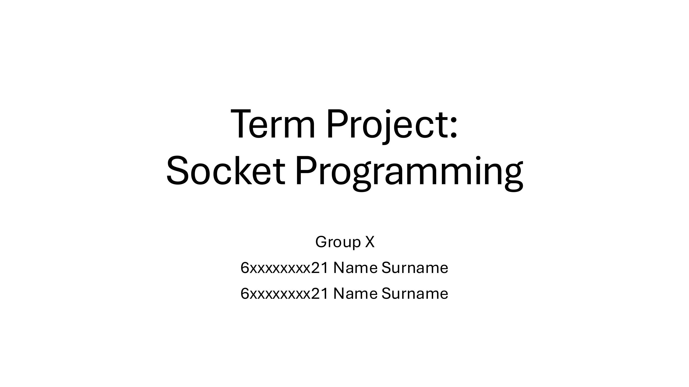

### Visual review note

Group X and both student identifier/name lines are template placeholders. They do not identify the project team.

## Page 2

### Source text

```text
Part 1 System Architecture Design
This part must be fully completed; otherwise, Part 2 will not be graded.
```

### Source visual evidence

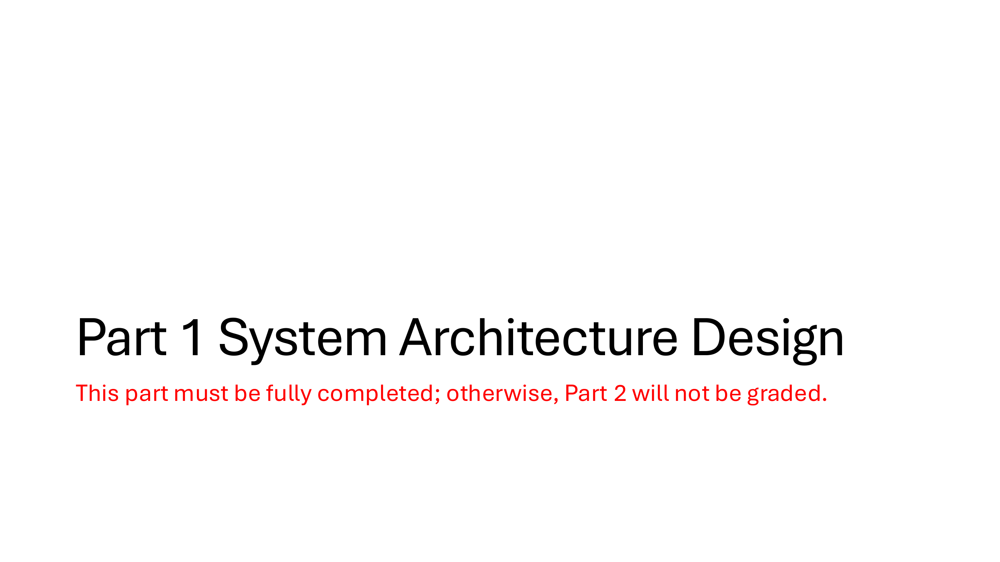

## Page 3

### Source text

```text
R1 – System Architecture Design


                System Architecture Diagram


• Explanation
```

### Source visual evidence

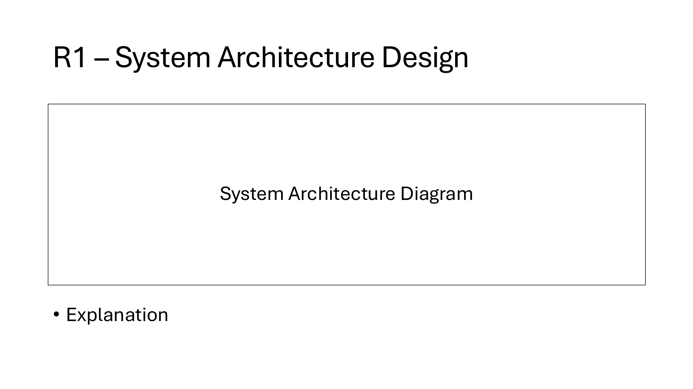

### Visual review note

The architecture diagram box is an empty template placeholder. The Explanation bullet also has no filled content.

## Page 4

### Source text

```text
R1 – System Architecture Design

• Explain the computer network protocols used in the project
    • What protocols are used
    • Why each protocol was selected
    • How each protocol is used within the project
```

### Source visual evidence

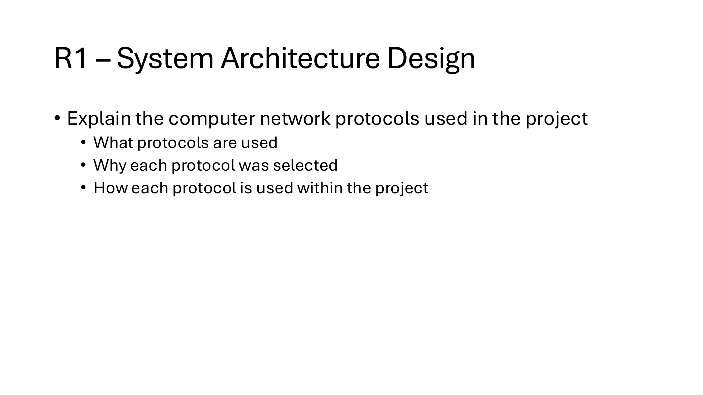

## Page 5

### Source text

```text
R2 – The chat messages between the server and each client
must be implemented using Socket Programming only


                   Code Snapshot


                  Generative AI Prompt (if use)
```

### Source visual evidence

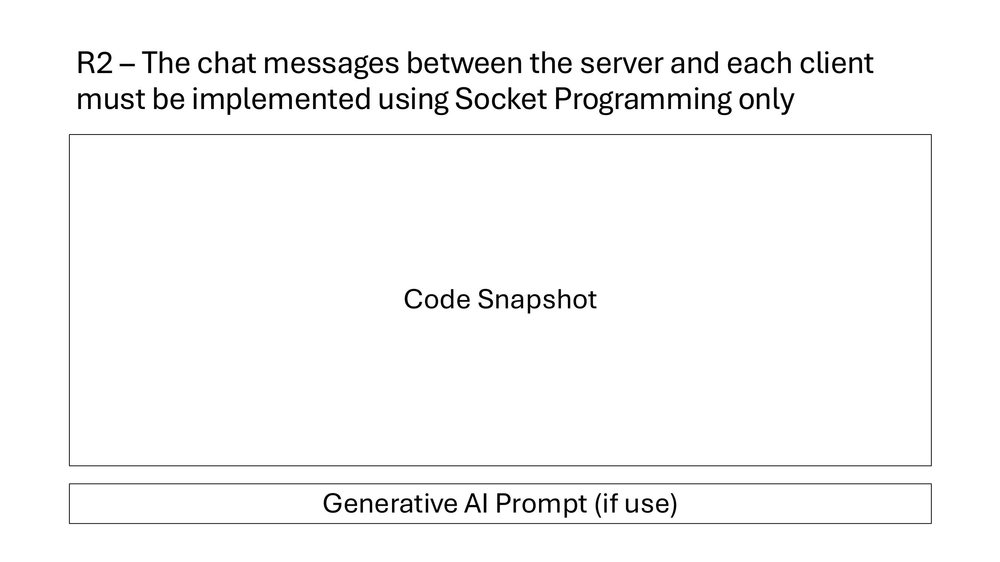

### Visual review note

The Code Snapshot box and the Generative AI Prompt (if use) box are empty template placeholders.

## Page 6

### Source text

```text
Part 2 Fundamental implementation
This part must be fully completed; otherwise, Part 3 will not be graded.
```

### Source visual evidence

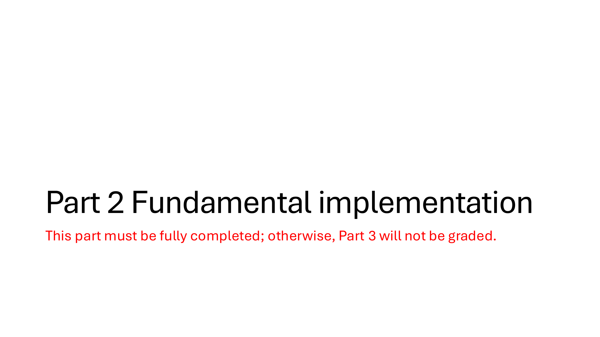

## Page 7

### Source text

```text
R3 – Each client must have a unique name.


 Code Snapshot (Mandatory)           Code Snapshot


                                   Generative AI Prompt (if use)
Generative AI Prompt (if use)
```

### Source visual evidence

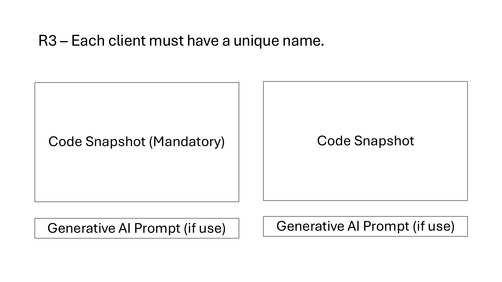

### Visual review note

The page has two empty code boxes. The left box says Code Snapshot (Mandatory). The right box says Code Snapshot. Each has an empty Generative AI Prompt (if use) box below it.

## Page 8

### Source text

```text
R4 – Each client can see a list of names of all clients that are
currently connected to the server including its own name


 Code Snapshot (Mandatory)           Code Snapshot


                                   Generative AI Prompt (if use)
Generative AI Prompt (if use)
```

### Source visual evidence

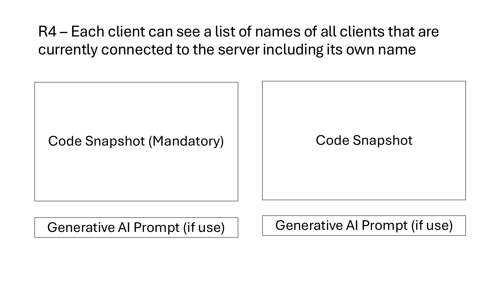

### Visual review note

The page has two empty code boxes. The left box says Code Snapshot (Mandatory). The right box says Code Snapshot. Each has an empty Generative AI Prompt (if use) box below it.

## Page 9

### Source text

```text
R5 – Chat between clients (both Private and Group message)
must have its own chat room


 Code Snapshot (Mandatory)           Code Snapshot


                                   Generative AI Prompt (if use)
Generative AI Prompt (if use)
```

### Source visual evidence

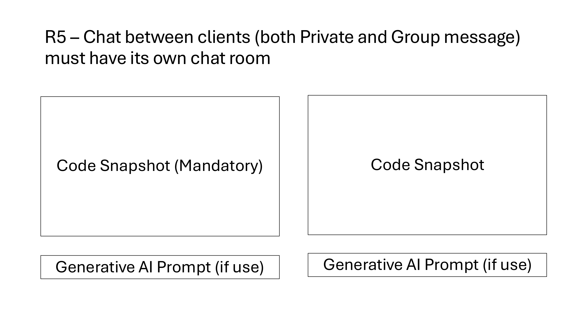

### Visual review note

The page has two empty code boxes. The left box says Code Snapshot (Mandatory). The right box says Code Snapshot. Each has an empty Generative AI Prompt (if use) box below it.

## Page 10

### Source text

```text
R6 – Each chat room (both Private and Group message) must include
a chat box for sending text messages and chat window for displaying
the sent messages and new incoming messages.


 Code Snapshot (Mandatory)           Code Snapshot


                                   Generative AI Prompt (if use)
Generative AI Prompt (if use)
```

### Source visual evidence

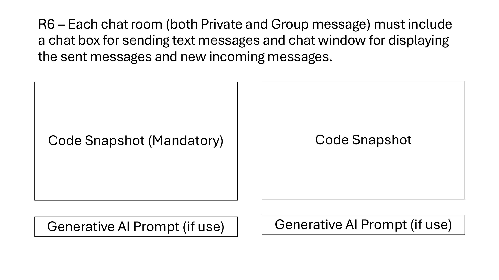

### Visual review note

The page has two empty code boxes. The left box says Code Snapshot (Mandatory). The right box says Code Snapshot. Each has an empty Generative AI Prompt (if use) box below it.

## Page 11

### Source text

```text
R7 – Each client can send a direct text message to any clients
in the list. Only the sender and receiver can see the messages.


 Code Snapshot (Mandatory)           Code Snapshot


                                   Generative AI Prompt (if use)
Generative AI Prompt (if use)
```

### Source visual evidence

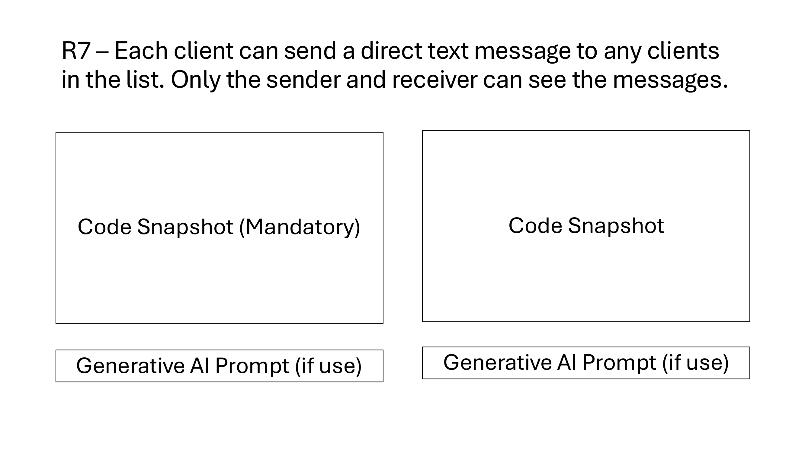

### Visual review note

The page has two empty code boxes. The left box says Code Snapshot (Mandatory). The right box says Code Snapshot. Each has an empty Generative AI Prompt (if use) box below it.

## Page 12

### Source text

```text
R8 – Each client can create a chat group(s), which initially
includes only themselves as a member.


 Code Snapshot (Mandatory)           Code Snapshot


                                   Generative AI Prompt (if use)
Generative AI Prompt (if use)
```

### Source visual evidence

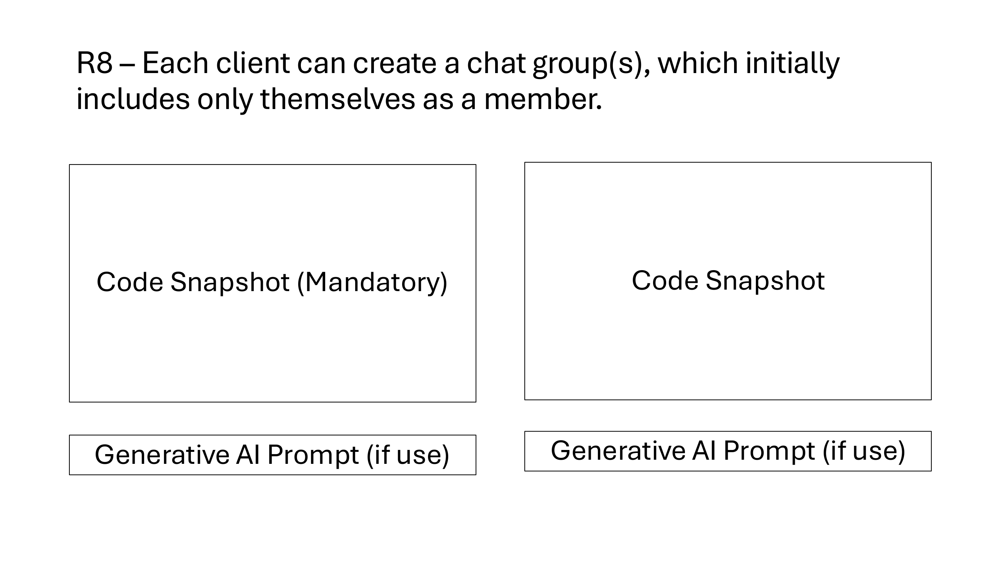

### Visual review note

The page has two empty code boxes. The left box says Code Snapshot (Mandatory). The right box says Code Snapshot. Each has an empty Generative AI Prompt (if use) box below it.

## Page 13

### Source text

```text
R9 – Each client can see a list of all existing chat groups (with
the member list) created by any clients.


 Code Snapshot (Mandatory)           Code Snapshot


                                   Generative AI Prompt (if use)
Generative AI Prompt (if use)
```

### Source visual evidence

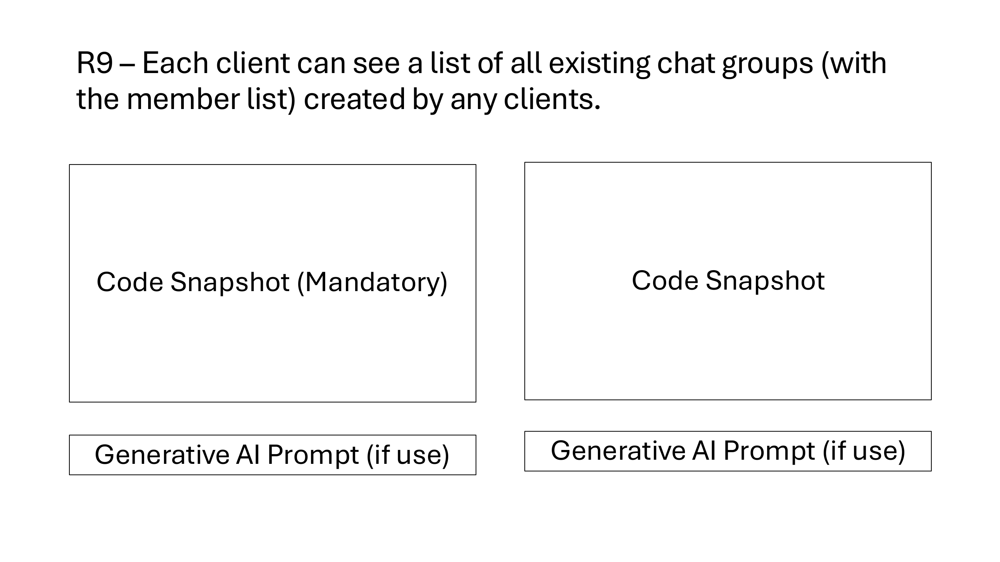

### Visual review note

The page has two empty code boxes. The left box says Code Snapshot (Mandatory). The right box says Code Snapshot. Each has an empty Generative AI Prompt (if use) box below it.

## Page 14

### Source text

```text
R10 – Clients can choose to join a group chat only by themselves; they
are not added automatically by the group creator.


 Code Snapshot (Mandatory)           Code Snapshot


                                   Generative AI Prompt (if use)
Generative AI Prompt (if use)
```

### Source visual evidence

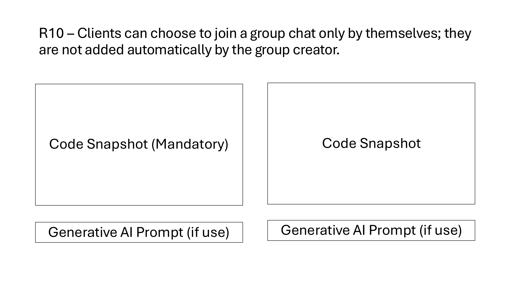

### Visual review note

The page has two empty code boxes. The left box says Code Snapshot (Mandatory). The right box says Code Snapshot. Each has an empty Generative AI Prompt (if use) box below it.

## Page 15

### Source text

```text
R11 – Each client can send a text message to the group that they
joined. Only the members of the chat group can see the messages.


 Code Snapshot (Mandatory)           Code Snapshot


                                   Generative AI Prompt (if use)
Generative AI Prompt (if use)
```

### Source visual evidence

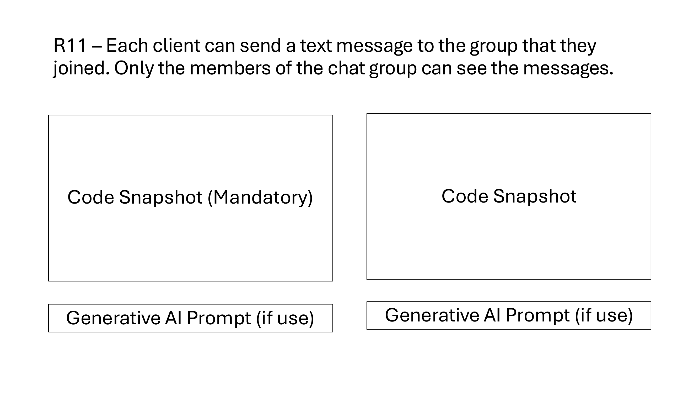

### Visual review note

The page has two empty code boxes. The left box says Code Snapshot (Mandatory). The right box says Code Snapshot. Each has an empty Generative AI Prompt (if use) box below it.

## Page 16

### Source text

```text
Part 3 Special Points
At least one of the features in the project must be an AI feature, such as speech-to-
text, text summarization, sentiment analysis, a chatbot, etc., to demonstrate the integration of AI
technologies into your system.
```

### Source visual evidence

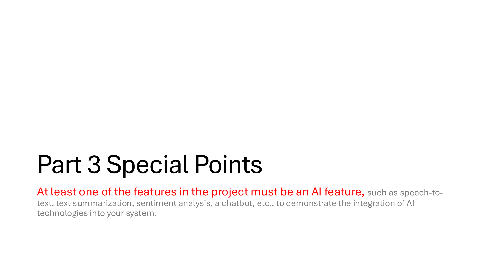

## Page 17

### Source text

```text
Special Point 1: (AI feature) ………….. (Description)
                         AI Model : ………….. (ref. ……….)


Code Snapshot (Mandatory)           Code Snapshot


                                 Generative AI Prompt (if use)
Generative AI Prompt (if use)
```

### Source visual evidence

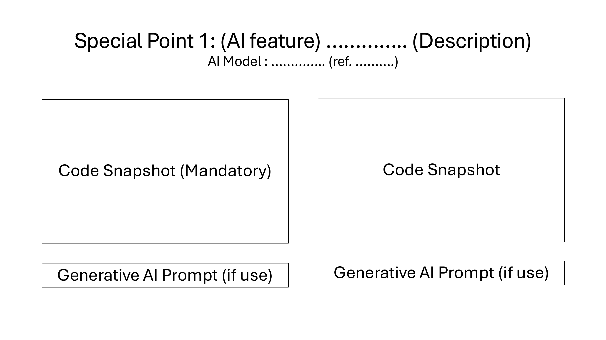

### Visual review note

The page has two empty code boxes. The left box says Code Snapshot (Mandatory). The right box says Code Snapshot. Each has an empty Generative AI Prompt (if use) box below it.

The description, AI Model, and reference fields are also unfilled template placeholders.

## Page 18

### Source text

```text
Special Point 2: ………….. (Description)


Code Snapshot (Mandatory)           Code Snapshot


                                 Generative AI Prompt (if use)
Generative AI Prompt (if use)
```

### Source visual evidence


### Visual review note

The page has two empty code boxes. The left box says Code Snapshot (Mandatory). The right box says Code Snapshot. Each has an empty Generative AI Prompt (if use) box below it.

The special-feature description is an unfilled template placeholder.

## Page 19

### Source text

```text
Special Point 3: ………….. (Description)


Code Snapshot (Mandatory)           Code Snapshot


                                 Generative AI Prompt (if use)
Generative AI Prompt (if use)
```

### Source visual evidence

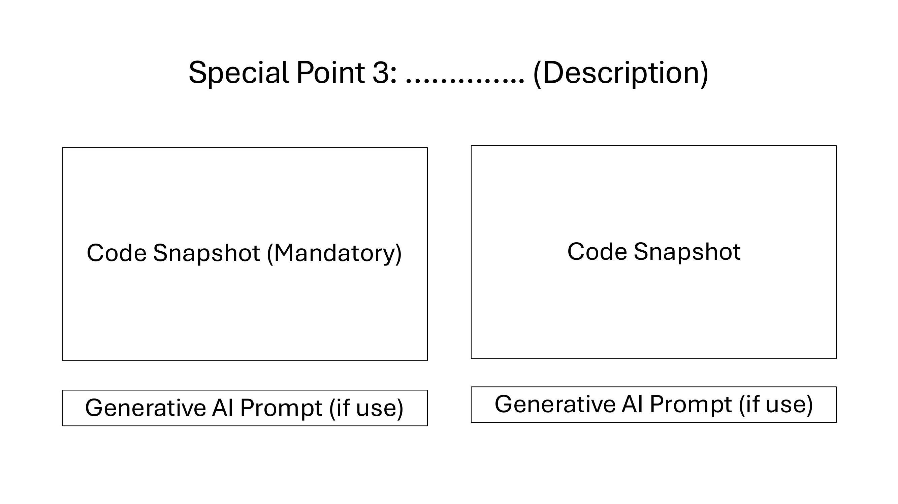

### Visual review note

The page has two empty code boxes. The left box says Code Snapshot (Mandatory). The right box says Code Snapshot. Each has an empty Generative AI Prompt (if use) box below it.

The special-feature description is an unfilled template placeholder.

## Page 20

### Source text

```text
Special Point 4: ………….. (Description)


Code Snapshot (Mandatory)           Code Snapshot


                                 Generative AI Prompt (if use)
Generative AI Prompt (if use)
```

### Source visual evidence

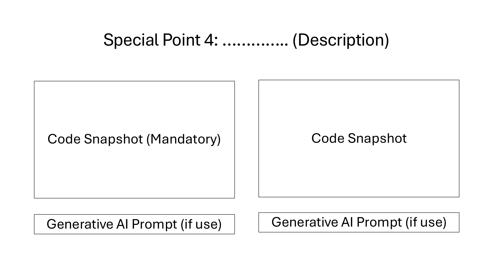

### Visual review note

The page has two empty code boxes. The left box says Code Snapshot (Mandatory). The right box says Code Snapshot. Each has an empty Generative AI Prompt (if use) box below it.

The special-feature description is an unfilled template placeholder.
