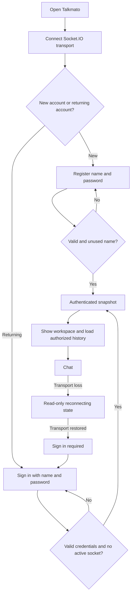
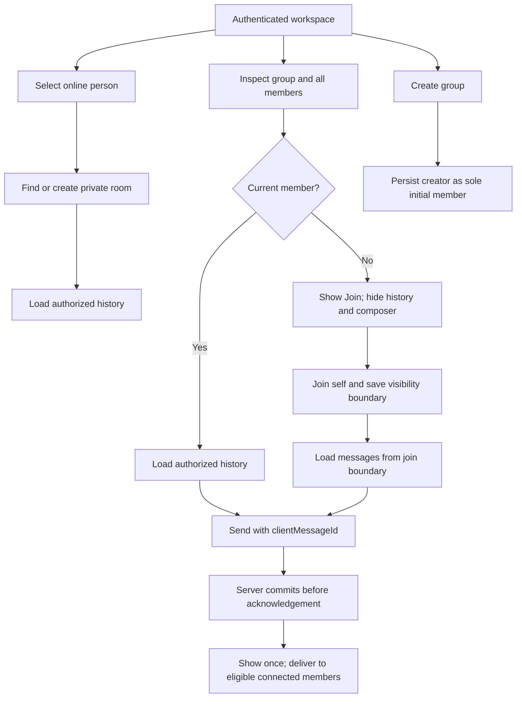

# Talkmato UI and interaction design

Talkmato is a tomato-themed browser chat app. The original user-supplied SVG exports in `docs/wireframes/` remain the visual/brand reference. They are static examples, not runtime evidence and not authority for outdated token-resume, tomato-reaction or AI Voice Chat behavior.

The current implementation baseline is full account registration/sign-in, room-scoped typing and an AI-selected emoji firework. See [architecture](architecture.md), [protocol](websocket-protocol.md), [data model](data-model.md) and [implementation ownership](implementation-ownership.md).

## Visual concept

- Use the supplied Talkmato logo and the CI-board palette: tomato red `#E7473F`, cream `#FFF8EE`, charcoal `#292725` and leaf green `#79A66A`.
- Desktop: online users/private chats/groups at left, conversation center, optional group member panel at right.
- Mobile: separate directory and active-chat views with a Conversations back action.
- Incoming messages are left aligned; own messages are right aligned.
- Public group details show online and offline members. The online-user directory contains connected users only, including self.

## Account flow

The browser never saves the password or a resume token. After successful sign-in, it receives an eight-hour HTTP-only cookie session; refresh/reopen restores the account only while that cookie is valid. The server then restores that account’s authorized rooms and saved history. Sign out revokes the session.

The signed-in workspace offers **Delete account**. It requires password confirmation and is irreversible: the account is signed out, old messages and remaining private-room labels display as `<Unknown>`, and its name becomes available to a new account.

## Figma source screens

| Source | Current use |
| --- | --- |
| Sign in / name error | Adapt to Register and Sign in forms with name/password fields and server errors. |
| Welcome | No selected conversation and authenticated shortcuts. |
| Private chat | Private conversation layout; do not treat tomato picker as selected behavior. |
| Create Group | Creator-only group modal. |
| Group preview / joined group | Member details before join, no pre-join messages, then member-only chat. |
| Disconnected | Cached conversation becomes read-only; after transport reconnect, ask the user to sign in. |
| Mobile screens | Directory-to-chat navigation. |
| AI Voice Chat | Not selected; omit or label unavailable. |

Keep all original SVG files unchanged. Do not restore a removed generated HTML mockup or silently alter the Figma exports.

## Rooms and chat flow

An existing private room remains usable when its peer is offline. Group creators cannot automatically add others. A first-time group member never sees older messages merely because artwork shows sample conversation text.

## Selected special features

| Feature | Behavior |
| --- | --- |
| Typing indicator | “Alex is typing…” is visible only to other eligible members of the active room. Never show draft text. Stop it on send, empty draft, room switch, sign-out/disconnect or expiry. It is never persisted. |
| AI emoji firework | A user invokes an accessible action on a visible message. After server authorization and AI selection from a fixed emoji allow-list, show a brief local firework animation anchored to that message. It is not a normal reaction, saved effect or room broadcast in the first version. Respect reduced-motion preference with a still emoji. |
| Account creation/sign-in | Persistent accounts make it possible to sign in later and retrieve authorized history. This is core project behavior; confirm separately with the instructor whether it receives a special-feature point. |
| AI Voice Chat / tomato reaction | Not selected. Omit from implementation even if visible in a static wireframe. |

## Action mapping

| Action | Event/state | Screen result |
| --- | --- | --- |
| Register | `auth.register` | Authenticate socket, show snapshot/workspace. |
| Sign in | `auth.login` | Authenticate socket, show same account’s rooms and load history. |
| Sign out | `auth.logout` | Return to sign-in view; durable data remains. |
| Select person | `private.open` | Open persisted pair room and load history. |
| Create group | `group.create` | Creator-only group; open it after success. |
| Join group | `group.join` | Add self, then enable history/composer from join boundary. |
| Load room | `room.history` | Loading state, messages and Load older. |
| Send | `room.send` with `clientMessageId` | Pending until acknowledgement; explicit retry uses same key. |
| Type | `typing.set` / `typing.updated` | Transient room-scoped status only. |
| AI emoji effect | `message.emojiSuggest` | Loading, then local allowed-emoji firework or recoverable error. |

## Accessibility and error states

- Use labeled native controls, visible focus and readable contrast.
- Forms must not retain or prefill password values after an error/logout.
- Use Enter to send and Shift+Enter for a newline; do not send during IME composition.
- Render message text as text, not HTML.
- Do not steal focus when live messages arrive.
- AI emoji actions must work by keyboard and touch, not hover only.
- Keep chat actions disabled while unauthenticated, disconnected or loading an authentication result.

| State | Copy/actions |
| --- | --- |
| Transport lost | “Connection lost. Reconnecting…”; cached messages read-only. |
| Transport restored | “Sign in to continue.”; no chat commands until authentication acknowledgement. |
| Invalid credentials | Generic “Name or password is incorrect.”; do not reveal account existence. |
| Session in use | Explain the account is active in another browser; allow retry after it closes. |
| History loading | “Loading saved messages…” with recoverable Retry. |
| Storage unavailable | Keep visible cache read-only; do not claim unsaved messages were accepted. |
| AI unavailable | Leave selected message unchanged and provide Retry; do not invent an AI result. |

Review with two physical-client machines and a third user where needed: account privacy, online list, private/group isolation, self-join, pre-join history exclusion, typing isolation, sign-out/sign-in history restoration, keyboard/touch AI action and reduced-motion behavior.
