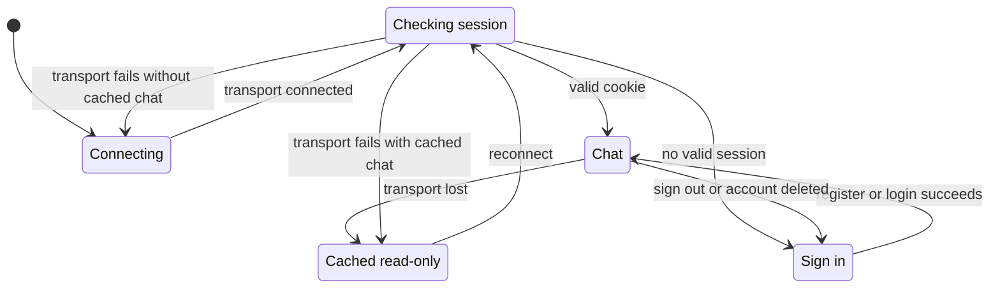

# UI and interaction

The user-supplied SVGs in [wireframes/](wireframes/) are the visual and brand reference. Keep their original bytes and filenames. Their token-resume, tomato-picker, and AI Voice Chat examples do not define current behavior.

Use the Talkmato logo and palette: tomato red `#E7473F`, cream `#FFF8EE`, charcoal `#292725`, and leaf green `#79A66A`. Incoming messages align left. Own messages align right. The desktop layout places directories beside the conversation. The mobile wireframes describe the compact visual reference.

## Account and connection lifecycle

`AuthGate` mounts `useAccountAuth` once. Chat consumes its socket and guarded request function. It does not open another connection. A valid cookie restores the account without replaying credentials. An absent/expired cookie requires sign-in. A second active socket receives `SESSION_IN_USE`.

During temporary loss, cached messages, selected room, and draft remain visible in memory. The workspace labels the directory as last known online. Server-backed actions, typing, history reads, and AI selection are disabled. Reconnect is available. Saved emoji replay remains local.

Live authentication clears immediately on disconnect. The separate display cache grants no access. Failed restoration, sign-out, account deletion, an uncertain deletion outcome, or a different restored account discards it. Same-account restoration refreshes the newest history window while retaining the selected room and draft. Older pages are then available from the refreshed cursor. No cache or credentials are saved in browser storage.

Registration uses a unique name, password, and confirmation. Sign-in uses the same name/password. Forms clear password fields after submission and show generic invalid-credential errors. Delete account requires password confirmation. It is irreversible and leaves old messages labeled `<Unknown>`.

## Conversation behavior

| Action | Result |
| --- | --- |
| Select an online person | Find/create the pair's private room. An existing room remains usable while its peer is offline. |
| Inspect a group | Show all members, including offline members. Nonmembers see metadata and Join, without history or a composer. |
| Create a group | Persist the creator as its only initial member. |
| Join | Add only the requester and load messages from the permanent first-join boundary. |
| Open a joined room | Load the newest 50 accessible messages. Merge live arrivals by message ID/sequence. |
| Load older | Request the previous page, preserve reading position, and stop when no cursor remains. |
| Retry history | Repeat the failed read with its original cursor. Keep already loaded messages visible. Late replies cannot replace another room or account. |
| Send | Await the saved result. An unknown outcome offers a manual retry with the same message ID. |
| Enter / Shift+Enter | Send / insert a newline. Enter during input-method composition never sends. |

Group names permit 1–64 Unicode code points. Messages permit 1–4000 and cannot be whitespace-only. A code point is a Unicode value, not a displayed glyph. An emoji with modifiers can contain several code points.

The online directory lists connected accounts, including the viewer. Group details include offline members. Message text renders as text, never HTML. History loading, storage failures, and unknown send results do not claim unsaved content was accepted.

## Typing and emoji effects

Typing appears only to other connected room members. It carries no draft text. The client throttles active updates and clears status on send, empty draft, room switch, sign-out, disconnect, or expiry. Typing is never stored.

The accessible diamond action sits beside each message without a saved emoji: right of received bubbles and left of sent bubbles. It disappears while selection is pending and after the first result is saved for all eligible readers. Failures offer manual retry. An amber dot marks a failed action, with an announced explanation and retry tooltip.

Saved emoji buttons replace the diamond in that position. Each attachment animates once per mounted chat session. Duplicate delivery, rerender, room switch, and same-account cached reconnect do not replay a seen attachment. Clicking a saved emoji replays locally without a request. Reloading or clearing the workspace resets this temporary replay state.

The firework covers the conversation pane without blocking input or moving with message scrolling. Every play samples fresh sizes, positions, travel, rotation, and timing. Reduced motion shows a still emoji. Keep keyboard/touch access, visible focus, labels, and readable contrast. Do not steal focus for live messages.

The [protocol](websocket-protocol.md#ai-selection-path) defines persisted authorization, provider limits, result reuse, and failure handling.
