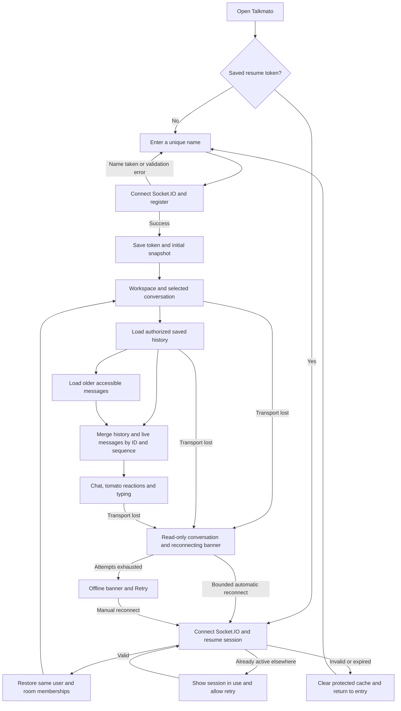
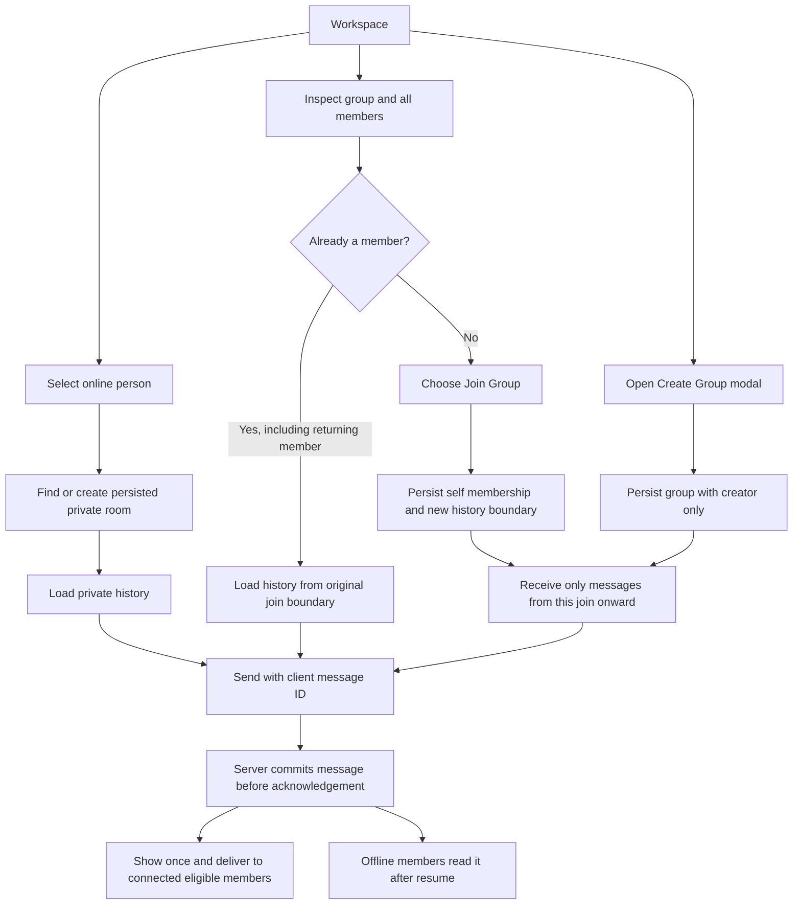

# Talkmato UI and interaction design

Talkmato combines “talk” and “tomato”: a friendly, tomato-themed browser chat app. The user-supplied Figma SVG exports in `docs/wireframes/` are the current visual reference, replacing the earlier generated interactive mockup. They show intended screens and sample data, not a working application or completed requirement evidence.

Next.js, TypeScript and Node.js/Socket.IO remain unchanged. The [protocol](websocket-protocol.md), [data model](data-model.md) and selected reconnect-with-history lifecycle remain the implementation baseline. Screen details not explicitly selected below remain proposals.

## Visual concept

- Use the supplied Talkmato logo and tomato motif, with the tagline “Small talks, fresh connections.”
- The CI board defines tomato red `#E7473F`, cream `#FFF8EE`, charcoal `#292725` and leaf green `#79A66A`. Use red for primary actions, green for connected/joined feedback and text labels alongside status colors.
- Desktop has a left directory for online users (including self), private chats and all groups; a central conversation; and a group-details panel opened with Members. Create Group is a modal, replacing the earlier inline-form proposal.
- Mobile has separate conversations/directory and active-chat views with a Conversations back action. Do not stack the entire desktop sidebar above every mobile conversation.
- Incoming messages sit left, own messages right. Each room has its own messages and draft. Show names, times, membership and connection state clearly.

## Figma source screens

| Source | Role |
| --- | --- |
| [CI board](wireframes/CI.svg) / [logo](wireframes/TalkmatoLogo.svg) | Brand colors and tomato asset |
| [Sign in](wireframes/login.svg) / [name error](wireframes/login%20-%20error.svg) | Name entry, feedback and join action |
| [Welcome](wireframes/Welcome%20%C2%B7%20No%20conversation%20selected.svg) | No active conversation; shortcuts reflect actual people/groups |
| [Private chat and tomato picker](wireframes/Private%20chat%20%C2%B7%20Alex%20and%20tomato%20picker.svg) | Private messages, tomato reaction control and typing status |
| [Create Group](wireframes/Create%20Group%20%C2%B7%20Creator-only%20modal.svg) | Modal explains creator-only initial membership |
| [Group preview](wireframes/Group%20preview%20%C2%B7%20Weekend%20plans%20before%20joining.svg) | Members visible before joining; no message content or enabled composer |
| [Joined group](wireframes/Group%20joined%20%C2%B7%20Weekend%20plans%20with%20Maya.svg) | Member list, group messages and joined feedback |
| [AI concept](wireframes/Joined%20group%20%C2%B7%20Tomato%20club%20and%20live%20AI%20voice.svg) | Provisional AI Voice Chat placement and live state |
| [Disconnected](wireframes/Disconnected%20%C2%B7%20Saved%20private%20conversation.svg) | Offline banner, last-known lists and disabled sending |
| [Mobile directory](wireframes/Mobile%20%C2%B7%20Conversations%20and%20all%20groups.svg) / [mobile chat](wireframes/Mobile%20%C2%B7%20Private%20chat%20with%20Alex.svg) | Directory-to-chat navigation and narrow-screen layout |

Keep these original SVG exports unchanged. Any future implementation correction belongs in code/documentation or a new Figma revision, not a silent edit to the reference image. The SVG text is outlined, so rendered images are the readable source.

## Selected additional feature direction

| Feature | Direction and boundary |
| --- | --- |
| Tomato reaction | Hover a received or sent message to reveal its reaction action, then choose the tomato. Display a tomato badge and count attached to that message; it is not a new text message. Allow the same action on keyboard focus and by tap on mobile. |
| Typing indicator | Show who is typing in the relevant private/group room, to other current members only. Never show draft text. Expire stale status automatically. |
| AI | Keep a reserved AI area. Figma depicts AI Voice Chat, but the user says the AI feature may change. Voice streaming, provider/model, microphone permissions, input scope and result recipients are not selected. Do not implement or promise live voice yet. |
| Cloud deployment | Planned special-feature slot from team discussion; provider and deployment remain unselected/unverified. |

These are the four planned Part 3 slots, not a claim that each has been awarded a point. Tomato reaction and typing are additions to R3–R11. File sharing and AI translation were suggestions, not selected features.

Proposed reaction behavior is one tomato per persistent user identity per message, with a second click removing it. Persist reactions with the message and version their summaries; check historical visibility before allowing a reaction. Desired enabled state makes repeat requests idempotent. History restore includes the latest authorized reaction state.

Proposed typing behavior is throttled updates while composing, stop on send/empty draft/room switch, and automatic expiry if a stop is missed. Stop indicators on disconnect and room closure. Treat IME composition as typing, but do not send a message while an IME composition is active.

## User flow

Reconnect with saved history replaces the earlier start-over behavior. The same browser/origin keeps a resume credential; persisted memberships and authorized messages return after refresh or reconnect. The storage design targets backend-restart durability, subject to persistent database hosting.

The flow's connect/resume errors remain visible until resolved. Network failure does not clear the credential or claim the user has left the group. Loading history is a separate state from an established socket.

First-time group joining still does not expose earlier history. Reconnecting an existing member is not a new join and keeps its earlier visibility boundary. Offline members remain in group details with an offline label. An existing private room stays usable while its peer is offline; opening a new room still starts from the online-user list.

## Action and event mapping

| Action | Event or state | Screen result |
| --- | --- | --- |
| First entry | `user.register` | On success save the resume token; show self and directories |
| Return/reconnect | `session.resume` after Socket.IO connect | Restore the same user ID, memberships and private rooms; only then enable authorized commands |
| Select person | `private.open` | Find persisted pair room and request history; show peer's current presence |
| Inspect/join group | Directory / `group.join` | Show all members including offline users; explicit first join, no pre-join content |
| Create group | `group.create` | Creator only; modal closes on success and opens its new room |
| Load conversation | `room.history` | Loading state, saved messages and Load older; merge live arrivals without duplicates |
| Send | `room.send` with `clientMessageId` | Pending until commit acknowledgement; show once by returned ID; manual unknown-outcome retry reuses the same key |
| React | `reaction.set` / `reaction.updated` | Persistent badge and per-user selection, with latest reaction version winning |
| Type | `typing.set` / `typing.updated` | Transient room-scoped status; never saved or replayed |
| Peer disconnects | Updated users/groups snapshots | Peer offline; keep room and history. Do not close the private room or remove group membership. |
| Own disconnect | Reconnecting state | Keep visible history read-only and draft in tab memory; disable writes while offline/resuming |
| Resume invalid/expired | Authentication error | Clear protected views and invalid token, return to entry; a name alone cannot retrieve prior history |

## Reconcile visual examples with selected behavior

1. **Name availability:** The green “name is available” artwork is provisional. The current protocol reserves the name persistently on `user.register`; before that response use neutral copy such as “Choose a unique name.” An offline name remains reserved; returning users use their saved credential. Do not imply a live availability check or guaranteed reservation that has no event implementation.
2. **Disconnected copy:** “Reconnect to pick up where you left off” and “Saved conversation” now match the selected direction. Show Reconnecting, Offline/Retry, Resuming session and Loading history distinctly. Do not show Connected until authentication succeeds. Keep cached messages read-only while offline, then reconcile with server history. Only the resume credential is in localStorage; server storage owns history.
3. **Joined-group samples:** Existing-looking conversations in the joined artwork are sample content. A first-time member sees only messages from its join boundary; do not backfill pre-join messages to match the image. A returning existing member can load authorized saved history, including messages from while it was offline.
4. **AI in nonmember/empty views:** A visible Start voice chat button is a placeholder, not permission to process that room. Until the feature is chosen, label it unavailable or omit it from implementation. Any future room-context AI must enforce membership and input/output scope.
5. **Creator label:** Creator can be a UI annotation. It does not grant invite, kick or automatic-add permissions under R10. Group IDs remain the authoritative identifiers even if display names match.
6. **Composer tomato button:** The artwork also shows a tomato next to Send. This does not replace the selected hover reaction flow. Its separate purpose (for example inserting a tomato into a draft) is not selected and should remain inactive until clarified.

## Accessibility and implementation checks

Use labeled native controls, visible focus and readable contrast. Reaction actions must be available through message focus and tap, not hover only; label them “React with tomato” and expose the user's selected reaction state. Keep the badge count visible after hover ends. Modal creation needs a label, focus containment, Escape/Cancel and focus return. Mobile details should remain accessible without the desktop third column.

Use Enter to send and Shift+Enter for a newline as shown in Figma, suppress submit during IME composition, and validate text against the protocol. Retain rejected drafts; do not automatically retry an unknown send. Offer explicit retry with the same client message ID. Do not steal focus for received events, and render messages as plain text. Persist the resume token in localStorage, save history server-side, and keep unsent drafts in tab memory only.

Review with two clients: group preview excludes content; creator-only creation; post-join-only messages; reaction and typing isolation from other rooms/nonmembers; one reaction per identity; missed typing-stop expiry; keyboard/touch reaction access; and resume with the same identity/history after disconnect, refresh and backend restart. AI is reviewed separately when chosen. None of the static SVG exports proves these runtime checks have passed.

## Reconnect and history UI states

| State | Copy and actions |
| --- | --- |
| Unexpected loss | “Connection lost. Reconnecting…”; cached messages read-only, composer/durable actions disabled |
| Transport restored | “Restoring your session…”; no chat commands until session acknowledgement |
| History loading | “Loading saved messages…”; merge live arrivals, show recoverable Retry on query error |
| Retry exhausted | “You're offline. Your saved history is on the server.” with Reconnect; do not promise local drafts survive refresh |
| Peer offline | Keep conversation and sending available once self is authenticated; show offline status, not a closed-room error |
| Older pages | Load older with progress/Retry; no cursor outside the user's history boundary |
| Empty new room | “No messages yet.”; newly joined group does not reveal older inaccessible content |
| Expired/invalid token | “We couldn't restore this session.” Return to entry without allowing name-only history access |
| Session in use | Explain another tab/connection is active; retry after it closes or stale transport cleanup finishes |
| Storage unavailable | Keep visible cache read-only; show Retry and never claim unsaved messages are accepted |

Use stable user/message IDs to preserve the active conversation and deduplicate restored messages. Test offline arrival, pagination/live races, persistent reactions, browser refresh, data retained after server restart, token invalidation and group membership restoration. Original SVGs are preserved; they remain static references rather than evidence that reconnect/persistence works.
