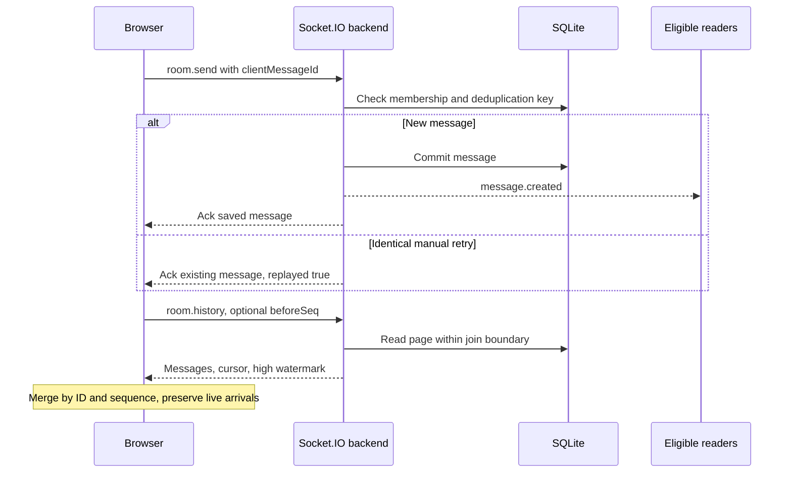
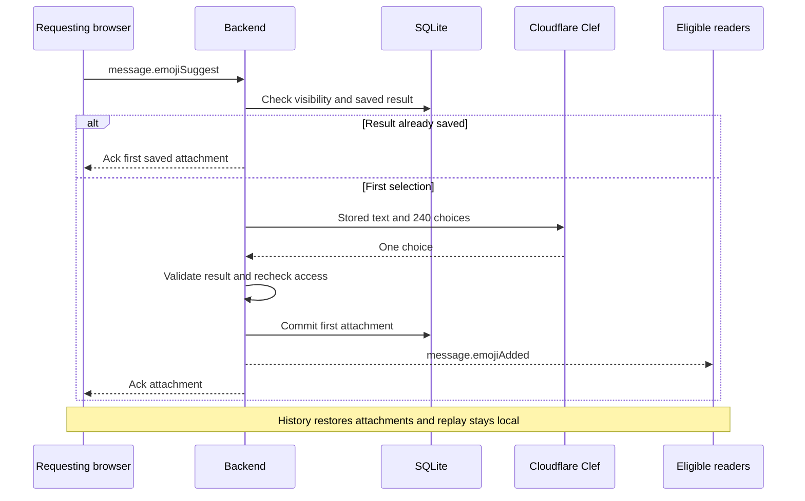

# Socket.IO protocol

Use `socket.io-client` and Node Socket.IO with WebSocket-only transport, path `/socket.io/`, and namespace `/`. Each command sends one object and an acknowledgement callback. Objects are not JSON strings, batches, or raw WebSocket frames.

Success is `{ok: true, data: ...}`. Failure is `{ok: false, error: {code, message}}`. Validate payloads at runtime. Derive the actor from the authenticated socket. Commit durable mutations before success or broadcast.

## Authentication and cookie exchange

Each connection checks the eight-hour HTTP-only cookie and emits `auth.session`. A valid session returns an account snapshot. Otherwise the payload is empty and registration/sign-in is required. The browser attempts at most five automatic transport reconnects, with delays from one to five seconds. Commands remain blocked until authentication succeeds.

After registration/login, the browser calls `POST /session` with credentials enabled and the authenticated socket ID in `x-talkmato-socket-id`. The HTTP server checks the configured origin, creates a server session, and sets `talkmato_session`. The cookie uses `HttpOnly`, `SameSite=Lax`, path `/`, an eight-hour maximum age, and `Secure` in production. Its opaque ID never enters a JavaScript response or browser storage.

`auth.logout` clears the socket's identity and delivery subscriptions. The client calls `DELETE /session` to revoke the current cookie's server record and expire the cookie. Account deletion revokes every session for that account. Disconnect alone retains sessions and saved data.

One account has one active socket. A competing login returns `SESSION_IN_USE`. Invalid name/password combinations return the same generic error. Public traffic uses HTTPS/WSS. No password, hash, or session ID belongs in URLs, logs, or public data.

## Client commands

| Event | Payload | Success data / rule |
| --- | --- | --- |
| `auth.register` | `{name, password}` | `{snapshot: AccountSnapshot}`. Reserve the canonical name and store an Argon2id hash. |
| `auth.login` | `{name, password}` | `{snapshot: AccountSnapshot}` after password verification. |
| `auth.logout` | `{}` | `{}`. Detach the current live identity. |
| `auth.deleteAccount` | `{password}` | `{}` after password confirmation and durable tombstoning. |
| `private.open` | `{peerId}` | `{room: PrivateRoom}`. Initial peer must be online and different from the actor. Existing rooms support offline peers. |
| `group.create` | `{name}` | `{group: Group}` with the creator as sole initial member. |
| `group.join` | `{roomId}` | `{group: Group}`. Join only self. Preserve the first-join history boundary. |
| `room.send` | `{roomId, clientMessageId, text}` | `{message: Message, replayed: boolean}`. Save once after membership checks. |
| `room.history` | `{roomId, beforeSeq?, limit?}` | `HistoryPage`. Default 50, maximum 100. Enforce persisted visibility on every page. |
| `typing.set` | `{roomId, isTyping}` | `{}`. Transient, member-only, without draft text. |
| `message.emojiSuggest` | `{roomId, messageId}` | `{emoji, attachment: MessageEmoji}`. Authorize the selected persisted message, then reuse or save its first result. |

Register/login reject an already authenticated socket with `ALREADY_AUTHENTICATED`. Other application commands reject unauthenticated sockets with `NOT_AUTHENTICATED`. A connected transport and cached display are not authentication.

The browser generates a UUID `clientMessageId`. Identical manual retries return `replayed: true` without another insert or broadcast. Different room/text with the same sender/key returns `CLIENT_MESSAGE_ID_CONFLICT`. No application write is retried automatically.

## Server events

| Event | Payload | Audience |
| --- | --- | --- |
| `auth.session` | `{snapshot?: AccountSnapshot}` | Newly connected socket after its session check. |
| `users.snapshot` | `{users: User[]}` | Authenticated clients. Connected users only, including the viewer. |
| `groups.snapshot` | `{groups: Group[]}` | Authenticated clients. All groups and online/offline member details. |
| `private.opened` | `{room: PrivateRoom}` | Online private participants after initial room creation. |
| `private.updated` | `{room: PrivateRoom}` | Remaining online peer after account deletion. Deleted peer becomes `<Unknown>`. |
| `message.created` | `Message` | Connected eligible room members, including sender. |
| `message.emojiAdded` | `{roomId, messageId, attachment: MessageEmoji}` | Connected readers who can see that message, including requester. Check each recipient's persisted visibility. |
| `typing.updated` | `{roomId, userId, isTyping, expiresInMs}` | Other connected members of that room. |

Successful register/login acknowledges its account snapshot before resulting directory events. Disconnect does not emit `room.closed` or delete rooms. Typing true expires after 3000 ms. Clear it on stop, send, empty draft, room switch, sign-out, disconnect, or expiry. It is never persisted or replayed.

## Public data

| Shape | Fields |
| --- | --- |
| User | `userId`, `name`, `online: boolean` |
| PrivateRoom | `roomId`, `kind: "private"`, `members: User[2]` |
| Group | `roomId`, `kind: "group"`, `name`, `members: User[]` |
| Message | `seq`, `messageId`, `clientMessageId`, `roomId`, `senderId`, `senderName`, `text`, `sentAt`, `emojis: MessageEmoji[]` |
| MessageEmoji | `emojiId`, `emoji`, `createdAt` |
| AccountSnapshot | `self: User`, `users: User[]`, `groups: Group[]`, `privateRooms: PrivateRoom[]` |
| HistoryPage | `roomId`, `messages: Message[]`, `nextBeforeSeq: number or null`, `highWatermarkSeq: number` |

`beforeSeq` is exclusive. History pages ascend by server sequence. `nextBeforeSeq` is the oldest returned sequence only when an older accessible page remains. `highWatermarkSeq` is the largest accessible room sequence at the query snapshot. Internal records and password hashes never enter these shapes. Account snapshots expose only the caller's private rooms.

## Message and history path



The client refreshes the newest window after session restoration, then continues older reads from the refreshed cursor. This avoids skipping messages sent during an outage. Failed reads offer Retry for the same query. Late responses cannot update another room or a later connection. The [UI reference](ui-ux.md) defines scrolling and display-cache behavior.

## AI selection path



The model is `@cf/cloudflare/clef`. One Choice question contains all 240 curated default-form candidates, within the 255-option limit. Only the selected stored text and choice descriptions reach the provider. Tone/intent takes priority. Neutral text uses a related subject. Unclear/unmatched meaning and unrecognized choices in otherwise valid data fall back to 🍅. Malformed data and provider failures remain errors.

Allow one request per account in flight, a one-second account start cooldown, one selection per message in flight, and two provider requests globally. Saved results bypass provider limits after authorization. The provider deadline is eight seconds, below the ten-second browser acknowledgement timeout. No provider request is automatically retried. These limits are temporary process state, not a spending cap.

Logout/disconnect cancels pending provider work. Recheck identity and message visibility afterward. Commit the first result before acknowledgement or delivery. Repeated requests return it without another provider call, insert, or event. History preserves legacy multi-emoji attachments. Browsers merge attachments by `emojiId`. Animation and local replay rules belong to [UI and interaction](ui-ux.md#typing-and-emoji-effects).

## Validation and errors

Normalize account names with trim and NFC. Reject Unicode `Cc` controls. Names permit 1–32 code points and use locale-independent lowercase for uniqueness. Passwords permit 8–128 code points. Group names permit 1–64 code points after trimming. Messages permit 1–4000 code points and cannot be whitespace-only.

| Code | Meaning |
| --- | --- |
| `INVALID_PAYLOAD` | Invalid fields or event arguments. |
| `NOT_AUTHENTICATED` / `ALREADY_AUTHENTICATED` | Identity state does not permit the command. |
| `NAME_TAKEN` | Canonical name belongs to an account, including an offline account. |
| `INVALID_CREDENTIALS` | Credentials or deletion confirmation failed. |
| `SESSION_IN_USE` | Account already has an active socket. |
| `USER_OFFLINE` / `SELF_CHAT_NOT_ALLOWED` | Invalid initial private-room peer. |
| `ROOM_NOT_FOUND` / `WRONG_ROOM_TYPE` / `NOT_MEMBER` | Room lookup, kind, or membership rejected. |
| `MESSAGE_NOT_AVAILABLE` | Missing selected message or exclusion by its join boundary. |
| `CLIENT_MESSAGE_ID_CONFLICT` | A deduplication key was reused with different content. |
| `AI_UNAVAILABLE` / `AI_INVALID_RESPONSE` | Provider access failed or returned malformed data. |
| `AI_RATE_LIMITED` | Account cooldown or account/message/global concurrency limit. |
| `STORAGE_UNAVAILABLE` / `INTERNAL_ERROR` | Operation failed without a durable success acknowledgement. |

Authorize before exposing room/type/message metadata. Public errors do not expose database or provider details.

## Request examples

These are individual Socket.IO calls with synthetic IDs. The acknowledgement is the return value, not another client command.

```js
const page = await socket.timeout(10000).emitWithAck('room.history', {
  roomId: 'g-study', beforeSeq: 101, limit: 50,
});
const result = await socket.timeout(10000).emitWithAck('room.send', {
  roomId: 'g-study', clientMessageId: crypto.randomUUID(), text: 'Hello',
});
// Success: {ok: true, data: {message: {...}, replayed: false}}
// Failure: {ok: false, error: {code: 'NOT_MEMBER', message: '...'}}
```

Application UI uses AuthGate's guarded request callback rather than emitting through a second socket.
